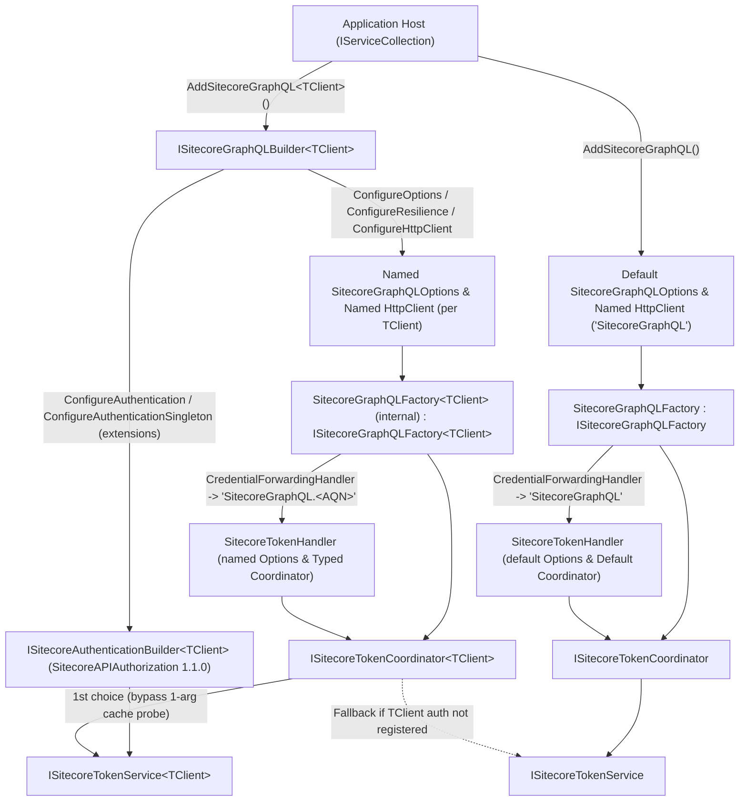

# .NET 10/11 Target Upgrade, `SitecoreAPIAuthorization` `1.1.0` Upgrade, and Typed GraphQL Factory (`ISitecoreGraphQLFactory<TClient>`)

*   **Author**: Aaron Metz
*   **Status**: Approved
*   **Date**: 2026-11-23

---

## Overview

`Sitecore.API.Foundation.GraphQL` (NuGet package `SitecoreAPIGraphQLClient`) provides a thread-safe GraphQL client factory, an OAuth2 bearer-token HTTP delegating handler ([`SitecoreTokenHandler`](../../src/Sitecore.API.Foundation.GraphQL/Http/SitecoreTokenHandler.cs)) with single-flight `401 Unauthorized` refresh and `HTTP POST` payload replay, and opt-in HTTP resilience for .NET applications calling Sitecore XM Cloud, Experience Edge, and Authoring/Management GraphQL APIs.

This design covers three coordinated changes for release `v1.1.0`:

1.  **Target Framework & Toolchain Upgrade (`net10.0;net11.0`)**: Drop end-of-support `.NET 8` and `.NET 9` targets across the library, test suite, benchmark suite, and GitHub Actions CI/CD workflows. Target `.NET 10` (LTS) and `.NET 11` (STS) with C# `15.0`, `.NET SDK 11.0.100`, `Microsoft.Extensions.*` `11.0.0`, and `BenchmarkDotNet` `0.16.0-preview.2`. Preserve historical `.NET 8.0` and `.NET 9.0` benchmark tables in [`README.md`](../../README.md) alongside updated `.NET 10.0` and `.NET 11.0` measurements.
2.  **`SitecoreAPIAuthorization` `1.1.0` Upgrade & Cache-Isolation Fix**: Upgrade [`SitecoreAPIAuthorization`](https://www.nuget.org/packages/SitecoreAPIAuthorization) from `1.0.0` to `1.1.0`, which targets `net10.0;net11.0` and introduces typed `ISitecoreTokenService<TClient>` with endpoint-partitioned caching inside `Sitecore.API.Foundation.Authorization.Abstractions.ISitecoreTokenCache` (referred to as `ISitecoreTokenCache` below unless contrasted with the obsolete GraphQL shim). Bypass the direct 1-argument `GetToken(credentials)` cache probe inside `SitecoreTokenCoordinator` (the internal singleton mediating bearer-token acquisition and single-flight `401`/manual refresh coalescing) whenever a typed token service is active so per-type authentication endpoints do not collide with the default `AuthTokenUrl` partition.
3.  **Typed Multi-Client GraphQL Registration (`AddSitecoreGraphQL<TClient>()`)**: Add generic dependency injection registration methods returning a fluent `ISitecoreGraphQLBuilder<TClient>`. Each registration isolates `ISitecoreGraphQLFactory<TClient> : ISitecoreGraphQLFactory`, named `SitecoreGraphQLOptions`, a named `HttpClient` and resilience pipeline, per-consumer telemetry tagging, and `.ConfigureAuthentication(...)` (Scoped) / `.ConfigureAuthenticationSingleton(...)` (Singleton) extension hooks delegating to `SitecoreAPIAuthorization` `1.1.0`.

## The Problem

1.  **Shared Global HTTP Pipeline, Resilience Settings, Auth Binding, and Telemetry**:
    Today, [`ServiceCollectionExtensions`](../../src/Sitecore.API.Foundation.GraphQL/DependencyInjection/ServiceCollectionExtensions.cs) registers a single untyped [`ISitecoreGraphQLFactory`](../../src/Sitecore.API.Foundation.GraphQL/ISitecoreGraphQLFactory.cs) backed by one unnamed `SitecoreGraphQLOptions` instance, one named `HttpClient` (`"SitecoreGraphQL"`), one [`SitecoreTokenHandler`](../../src/Sitecore.API.Foundation.GraphQL/Http/SitecoreTokenHandler.cs) configuration, and one resilience pipeline. Although `SitecoreGraphQLOptions.Clients` supports string-keyed named clients (`CreateClientByNameAsync("authoring")`), all consumers in the host share:
    *   The same `HttpClient` builder configuration (timeouts, message handlers, proxies, certificates).
    *   The same `HttpStandardResilienceOptions` policy (retry counts, circuit-breaker thresholds, total timeout).
    *   The same untyped `ISitecoreTokenService` and default `AuthTokenUrl`.
    *   The same `"default"` telemetry bucket when invoking default-credential factory methods across multiple environments.

    Applications integrating with separate Sitecore environments or APIs (such as Staging vs. Production XM Cloud, or Authoring vs. Experience Edge) cannot isolate GraphQL HTTP pipelines, resilience policies, telemetry dimensions, or per-consumer authentication endpoints by C# consumer type.
2.  **Incompatibility with `SitecoreAPIAuthorization` `1.1.0` and Typed Token Services**:
    *   `SitecoreAPIGraphQLClient` `1.0.0` references `SitecoreAPIAuthorization` `1.0.0` and targets `net8.0;net9.0;net10.0`. [`SitecoreAPIAuthorization`](https://www.nuget.org/packages/SitecoreAPIAuthorization) `1.1.0` dropped `net8.0`/`net9.0` in favor of `net10.0;net11.0` and introduced `ISitecoreTokenService<TClient>` with endpoint-partitioned caching keyed by `(SitecoreAuthClientCredentials, AuthTokenUrl)` inside `ISitecoreTokenCache`.
    *   `SitecoreAPIAuthorization` `1.1.0` stores each typed consumer's `AuthTokenUrl` in a named `SitecoreTokenServiceOptions` registration keyed by `internal Constants.SitecoreOptionsNamePrefix`, and exposes both a 1-argument `GetToken(credentials)` overload (reading the default unnamed `AuthTokenUrl` partition) and a 2-argument `GetToken(credentials, authTokenUrl)` overload on `ISitecoreTokenCache`.
    *   Even after bumping the package reference, [`SitecoreTokenCoordinator`](../../src/Sitecore.API.Foundation.GraphQL/Internal/ISitecoreTokenCoordinator.cs) resolves only untyped `ISitecoreTokenService` and directly probes the 1-argument `GetToken(credentials)` overload. Because `Constants.SitecoreOptionsNamePrefix` is `internal`, GraphQL code cannot look up a typed consumer's `AuthTokenUrl` to call the 2-argument `GetToken(credentials, authTokenUrl)` overload, so the 1-argument probe checks the wrong partition whenever a typed consumer uses a non-default `AuthTokenUrl`.
3.  **Collision Risk with `AddHttpClient<TClient>()`**:
    Typed API consumers are frequently registered via `services.AddHttpClient<TClient>()`. If typed GraphQL registration registered `TClient` directly in `IServiceCollection` or reused `typeof(TClient).Name` as the `HttpClient` name, it would overwrite the consumer's DI registration or corrupt the consumer's own `HttpClient` configuration.
4.  **Out-of-Support Target Frameworks (`.NET 8` and `.NET 9`)**:
    With `.NET 11` released in November 2026, `.NET 8` and `.NET 9` have reached end of support. Retaining `net8.0` and `net9.0` blocks upgrading to `SitecoreAPIAuthorization` `1.1.0` and maintains CI/test/benchmark matrix overhead for unsupported runtimes.

## Goals

*   Drop `net8.0` and `net9.0` across all projects and CI/CD workflows, targeting `net10.0;net11.0` with `.NET SDK 11.0.100`, C# `15.0`, `SitecoreAPIAuthorization` `1.1.0`, and `Microsoft.Extensions.*` `11.0.0` for release `v1.1.0` (see Phase 1 for the file manifest).
*   Refresh [`README.md`](../../README.md) with measured `.NET 10.0` and `.NET 11.0` benchmark results while preserving the existing `.NET 8.0` and `.NET 9.0` benchmark rows in a historical reference subsection.
*   Introduce public `ISitecoreGraphQLFactory<TClient> : ISitecoreGraphQLFactory` (`where TClient : class`) backed by an internal `SitecoreGraphQLFactory<TClient>` implementation so consumers can inject a strongly typed GraphQL factory alongside their own `HttpClient` without colliding with `AddHttpClient<TClient>()`.
*   Introduce `AddSitecoreGraphQL<TClient>(...)` overloads returning a fluent `ISitecoreGraphQLBuilder<TClient>`. Support per-type `SitecoreGraphQLOptions` (delegate or `IConfiguration` section), per-type `HttpStandardResilienceOptions` (preserving `AllowPostRetries`, which guards `HTTP POST` GraphQL mutations from retries unless opted in), per-type `IHttpClientBuilder` customization, and `.ConfigureAuthentication(...)` / `.ConfigureAuthenticationSingleton(...)` extensions delegating to `SitecoreAPIAuthorization` `1.1.0`.
*   Emit a low-cardinality, assembly-version-stable `client.type` telemetry tag on typed pipeline metrics and activities so multi-environment hosts can distinguish typed consumers without changing untyped telemetry.
*   Resolve `ISitecoreTokenService<TClient>` first inside `TClient`'s token coordinator with automatic fallback to untyped `ISitecoreTokenService`, and bypass the 1-argument `ISitecoreTokenCache` probe when a typed token service is active so per-type `AuthTokenUrl` partitions remain isolated.
*   Maintain source and binary backward compatibility on `net10.0;net11.0` (subject to the `Microsoft.Extensions.*` `11.0.0` dependency floor noted in Risks) for all existing non-generic `AddSitecoreGraphQL(...)` overloads (still returning `IServiceCollection`), `ISitecoreGraphQLFactory` methods, named clients (`Clients["name"]`), and legacy constructors.

## Non-Goals

*   Registering the consumer type `TClient` itself in `IServiceCollection` or modifying the `HttpClient` registered by a caller's own `services.AddHttpClient<TClient>()` call.
*   Introducing a new GraphQL execution wrapper interface (`ISitecoreGraphQLClient<TClient>`) that duplicates `IGraphQLClient` query/mutation methods.
*   Changing the return type of existing non-generic `AddSitecoreGraphQL(...)` extension methods from `IServiceCollection`.
*   Retaining `net8.0` or `net9.0` compilation targets in the NuGet package, test suite, or benchmark runner.
*   Removing existing named-client support (`SitecoreGraphQLOptions.Clients`, `CreateClientByNameAsync`, `RefreshTokenByNameAsync`) or the obsolete `v0.9.x`/`v1.0.x` GraphQL compatibility shim [`Sitecore.API.Foundation.GraphQL.ISitecoreTokenCache`](../../src/Sitecore.API.Foundation.GraphQL/Abstractions/ISitecoreTokenCache.cs) (distinct from `SitecoreAPIAuthorization`'s `Sitecore.API.Foundation.Authorization.Abstractions.ISitecoreTokenCache`).
*   Extracting the duplicated inline `python3` coverage gate script across [`.github/workflows/pr-check.yml`](../../.github/workflows/pr-check.yml) and [`.github/workflows/nuget-release.yml`](../../.github/workflows/nuget-release.yml) into a standalone helper script (that script enforces `>= 80%` overall and public API line coverage by matching Cobertura XML class names against a `public_prefixes` list; extraction is deferred to keep `v1.1.0` CI diffs focused on `.NET 10/11` and coverage prefixes).

## Open Questions

*   None — typed registration model (`ISitecoreGraphQLFactory<TClient>` + `ISitecoreGraphQLBuilder<TClient>`), authentication wiring (`.ConfigureAuthentication(...)` with typed-first fallback), and release version (`1.1.0`) were confirmed before drafting.

## Critical User Journeys (CUJs)

### CUJ 1: Multi-Environment Host Registers Typed GraphQL Factories with Isolated Auth and Resilience

*   **Given**: An application on `.NET 10` or `.NET 11` has two consumer services, `AuthoringSyncService` and `DeliveryQueryService`, each optionally registered with `services.AddHttpClient<TClient>()`, injecting `ISitecoreGraphQLFactory<AuthoringSyncService>` and `ISitecoreGraphQLFactory<DeliveryQueryService>` respectively.
*   **When**: The host registers both typed factories:

    ```csharp
    services.AddSitecoreGraphQL<AuthoringSyncService>(configuration, "Sitecore:GraphQL:Authoring")
        .ConfigureResilience(r => r.TotalRequestTimeout.Timeout = TimeSpan.FromSeconds(60))
        .ConfigureAuthentication(auth => auth.ConfigureOptions(o =>
            o.AuthTokenUrl = "https://staging-auth.sitecorecloud.io/oauth/token"));

    services.AddSitecoreGraphQL<DeliveryQueryService>(opts =>
        {
            opts.Endpoint = "...";
            opts.ClientId = "...";
            opts.ClientSecret = "...";
            opts.AllowPostRetries = true;
        })
        .ConfigureResilience(r => r.Retry.MaxRetryAttempts = 3)
        .ConfigureAuthentication(auth => auth.ConfigureOptions(o =>
            o.AuthTokenUrl = "https://auth.sitecorecloud.io/oauth/token"));
    ```

*   **Then**:
    *   Both factories resolve independently with isolated named `SitecoreGraphQLOptions`, `HttpClient` pipelines, resilience policies, and `ISitecoreTokenService<TClient>` instances.
    *   `401 Unauthorized` refreshes coalesce and route through each consumer's `AuthTokenUrl` without cross-endpoint cache collisions.
    *   Telemetry tags each consumer via `client.type`, and neither registration collides with `services.AddHttpClient<TClient>()`.

### CUJ 2: Typed GraphQL Consumer Shares a Single Untyped `AddSitecoreAuthentication(...)` Registration

*   **Given**: A host registers shared authentication via `services.AddSitecoreAuthentication(configuration)` from `SitecoreAPIAuthorization` for the standard Sitecore Cloud OAuth endpoint and registers two typed GraphQL factories (`AddSitecoreGraphQL<CatalogClient>(...)` and `AddSitecoreGraphQL<SearchClient>(...)`) without calling `.ConfigureAuthentication(...)` or `SitecoreAPIAuthorization`'s `AddSitecoreAuthentication<TClient>()`.
*   **When**: Either typed factory acquires or refreshes a bearer token.
*   **Then**: The typed coordinator checks for `ISitecoreTokenService<TClient>`, falls back to the untyped `ISitecoreTokenService`, logs a one-time informational message, and acquires/refreshes tokens without per-type auth configuration while keeping each typed client's GraphQL endpoint, credentials, HTTP handlers, and resilience pipeline isolated.

### CUJ 3: Existing Untyped Consumer Upgrades From `1.0.0` to `1.1.0`

*   **Given**: An existing application on `.NET 10` or `.NET 11` (with `Microsoft.Extensions.*` `>= 11.0.0` if using Central Package Management (CPM)) calls `services.AddSitecoreAuthentication(configuration)` and `services.AddSitecoreGraphQL(configuration, configureResilience, configureClient)` (chaining additional `IServiceCollection` calls) and injects `ISitecoreGraphQLFactory` using default, named, or explicit client methods.
*   **When**: The application upgrades `SitecoreAPIGraphQLClient` to `1.1.0` (which brings in `SitecoreAPIAuthorization` `1.1.0`).
*   **Then**: All existing registration chains, `ISitecoreGraphQLFactory` method calls, `ValidateOnStart()` checks, named clients, and `SitecoreTokenHandler` behaviors compile and run unchanged.

### CUJ 4: Developer or CI Runner Builds, Tests, Benchmarks, and Packs on `.NET 10` and `.NET 11`

*   **Given**: A developer workstation or GitHub Actions runner with `.NET 10` and `.NET 11` SDKs installed.
*   **When**: A developer or CI runner executes `dotnet build --configuration Release`, `dotnet test --configuration Release` across `net10.0` and `net11.0`, `dotnet pack`, and the `BenchmarkDotNet` suite.
*   **Then**:
    *   All three projects build with 0 warnings (`TreatWarningsAsErrors=true`), and tests (including [`GitHubWorkflowTests.cs`](../../tests/Sitecore.API.Foundation.GraphQL.Tests/GitHubWorkflowTests.cs), the CI and packaging contract test suite) pass with `>= 80%` overall and public API line coverage on both `net10.0` and `net11.0`.
    *   The packed `.nupkg` declares the 9 direct runtime dependencies in the `net10.0` Target Framework Moniker (TFM) group and the 7 non-pruned runtime dependencies in the `net11.0` TFM group (where `.NET 11` SDK `AddPrunePackageReferences` omits `Microsoft.Extensions.Logging.Abstractions` and `Microsoft.Extensions.Options` because they are included in `Microsoft.NETCore.App`), referencing `SitecoreAPIAuthorization` `>= 1.1.0`.
    *   [`README.md`](../../README.md) displays both the new `.NET 10.0`/`.NET 11.0` benchmark results and the preserved `.NET 8.0`/`.NET 9.0` historical rows.

## Technical Plan (Architecture)

### 1. Component Architecture & Data Flow

The architecture extends the existing layered module layout (`Abstractions` <- `Internal` <- `Http` <- root `SitecoreGraphQLFactory` <- `DependencyInjection`) without introducing circular dependencies or adding new runtime NuGet packages.



```text
+-------------------------------------------------------------------------------------------------+
| Application Consumer: ConsumerService(HttpClient, ISitecoreGraphQLFactory<TClient>)             |
+-------------------------+-------------------------------------------------+---------------------+
                          |                                                 |
            Injected via  |                                   Injected via  |
AddHttpClient<TClient>()  |                  AddSitecoreGraphQL<TClient>()  |
                          v                                                 v
+-------------------------+-------------------+   +-------------------------+---------------------+
| Consumer's Own API HttpClient               |   | SitecoreGraphQLFactory<TClient> (internal)    |
| (Named: typeof(TClient).Name)               |   | - Named Options: "...Options.<AQN>"           |
+---------------------------------------------+   | - Named HttpClient: "SitecoreGraphQL.<AQN>"   |
                                                  +-----------------------------------------------+
```

*(Where `<AQN>` denotes `typeof(TClient).AssemblyQualifiedName` and `"...Options"` denotes `OptionsNamePrefix = "Sitecore.API.Foundation.GraphQL.Options"`.)*

### 2. Typed Factory Contract & Observability Boundary

1.  **`ISitecoreGraphQLFactory<TClient>` ([`ISitecoreGraphQLFactory.cs`](../../src/Sitecore.API.Foundation.GraphQL/ISitecoreGraphQLFactory.cs))**:
    *   Public marker interface inheriting `ISitecoreGraphQLFactory` with `where TClient : class`:

        ```csharp
        public interface ISitecoreGraphQLFactory<TClient> : ISitecoreGraphQLFactory
            where TClient : class
        {
        }
        ```

    *   Exposes all 6 factory operations (`CreateClientAsync` overloads, `CreateClientByNameAsync`, `RefreshTokenAsync`, `RefreshTokenByNameAsync`) scoped to `TClient`'s isolated configuration and HTTP pipeline. Note that parameterless `RefreshTokenAsync()` refreshes all unique `(ClientId, ClientSecret)` credential sets configured on that factory (default credentials plus distinct named `Clients`), whereas `RefreshTokenByNameAsync(name)` refreshes a single named client.
2.  **`SitecoreGraphQLFactory<TClient>` ([`SitecoreGraphQLFactory.cs`](../../src/Sitecore.API.Foundation.GraphQL/SitecoreGraphQLFactory.cs))**:
    *   Declared as an `internal sealed` subclass of `SitecoreGraphQLFactory` that implements `ISitecoreGraphQLFactory<TClient>` via the base class's extended `internal` constructor (preventing `CS0051` exposure of internal `ISitecoreTokenCoordinator` and avoiding an unconstructable public concrete class).
    *   Each typed factory binds exclusively to its named `SitecoreGraphQLOptions` and named `HttpClient` pipeline via [`CredentialForwardingHandler`](../../src/Sitecore.API.Foundation.GraphQL/Internal/CredentialForwardingHandler.cs) — an internal `HttpMessageHandler` wrapper that attaches per-client credentials to outbound requests and delegates to a freshly resolved `IHttpClientFactory` client, preserving 2-minute DNS handler rotation without per-client sockets.
    *   Resolves its named options via `IOptionsMonitor.Get(_optionsName)` for hot-reload (while base `SitecoreGraphQLFactory` retains the unnamed `CurrentValue` fallback for untyped callers and test mocks), and emits category-typed `ILogger<SitecoreGraphQLFactory<TClient>>` logs.
3.  **Per-Consumer Telemetry Separation ([`SitecoreGraphQLDiagnostics.cs`](../../src/Sitecore.API.Foundation.GraphQL/SitecoreGraphQLDiagnostics.cs))**:
    *   Metrics tag operations with `client.name` (returned by the existing `GetClientTag` helper: `"default"`, a named client key from `Clients`, or `"explicit"`).
    *   Typed pipelines attach a low-cardinality `client.type` tag formatted via BCL `typeof(TClient).ToString()` to `TokenRequests`, `TokenRefreshes`, `TokenRefreshDurationMs`, `AuthRetries`, `ClientCacheEvictions` (metric `sitecore.graphql.client_cache.evictions`), and `Activity` spans. Unlike CLR `Type.FullName` (which embeds assembly-qualified `Version=` strings for closed-generic type arguments), `Type.ToString()` formats regular classes, closed generics, nested generics, and arrays without `Version=` drift in the `client.type` tag.
    *   `ClientCacheEvictions` occurs at the factory-cache level across dynamic clients, so it omits `client.name` and emits only `client.type` on typed factories (remaining untagged on untyped factories). Untyped registrations omit `client.type` on all metrics and activities.

### 3. Fluent Builder & Typed Dependency Injection (`DependencyInjection`)

1.  **Core Interface `ISitecoreGraphQLBuilder<TClient>` (`src/Sitecore.API.Foundation.GraphQL/DependencyInjection/ISitecoreGraphQLBuilder.cs`)**:
    *   Kept minimal and decoupled from `Sitecore.API.Foundation.Authorization.DependencyInjection`:

        ```csharp
        public interface ISitecoreGraphQLBuilder<TClient>
            where TClient : class
        {
            IServiceCollection Services { get; }

            ISitecoreGraphQLBuilder<TClient> ConfigureOptions(Action<SitecoreGraphQLOptions> configure);
            ISitecoreGraphQLBuilder<TClient> ConfigureOptions(IConfiguration configuration, string sectionName = "Sitecore:GraphQL");
            ISitecoreGraphQLBuilder<TClient> ConfigureResilience(Action<HttpStandardResilienceOptions>? configureResilience = null);
            ISitecoreGraphQLBuilder<TClient> ConfigureHttpClient(Action<IHttpClientBuilder> configureClient);
        }
        ```

2.  **Entry Points & Fluent Authentication Extensions ([`ServiceCollectionExtensions.cs`](../../src/Sitecore.API.Foundation.GraphQL/DependencyInjection/ServiceCollectionExtensions.cs))**:
    *   Generic entry points (all 4 non-generic `AddSitecoreGraphQL(...)` overloads remain unchanged and return `IServiceCollection`):
        *   `AddSitecoreGraphQL<TClient>(this IServiceCollection services, Action<SitecoreGraphQLOptions>? configure = null)`
        *   `AddSitecoreGraphQL<TClient>(this IServiceCollection services, IConfiguration configuration, string sectionName = "Sitecore:GraphQL")`
    *   Fluent authentication extension methods in `Sitecore.API.Foundation.GraphQL.DependencyInjection` delegating to `SitecoreAPIAuthorization` `1.1.0`'s `AddSitecoreAuthentication<TClient>()` / `AddSitecoreAuthenticationSingleton<TClient>()` so callers chain auth setup without coupling `ISitecoreGraphQLBuilder<TClient>` to upstream auth builder types:
        *   `ConfigureAuthentication<TClient>(...)`: registers `ISitecoreTokenService<TClient>` with **Scoped** lifetime (default; supports `IOptionsMonitor` runtime hot-reload of `AuthTokenUrl`).
        *   `ConfigureAuthenticationSingleton<TClient>(...)`: registers `ISitecoreTokenService<TClient>` with **Singleton** lifetime (avoids per-scope service allocation for static configurations; snapshots `AuthTokenUrl` once at startup without hot-reload).
3.  **Isolation & Idempotency Invariants**:
    *   **Cross-Assembly Naming Isolation**: Named `HttpClient` (`"SitecoreGraphQL.<AQN>"`) and named `SitecoreGraphQLOptions` (`"Sitecore.API.Foundation.GraphQL.Options.<AQN>"`) keys derive from `TClient`'s `AssemblyQualifiedName` for parity with `SitecoreAPIAuthorization` `1.1.0`. This prevents collisions with `AddHttpClient<TClient>()` (keyed by short type name) and same-named types in distinct assemblies. `IHttpClientFactory`/Polly pipeline names and `SitecoreGraphQLOptionsValidator` prefixes embed `<AQN>`, while `SitecoreGraphQLDiagnostics`'s `client.type` tag uses version-stable `typeof(TClient).ToString()`.
    *   **Idempotent Builder Reuse**: Per-`(IServiceCollection, TClient)` builder instances are weakly associated with the target `IServiceCollection` via `ConditionalWeakTable`. Repeated `AddSitecoreGraphQL<TClient>()` or `.ConfigureResilience(...)` calls reuse one `SitecoreTokenHandler` and one standard resilience pipeline without registering builders in DI or pinning containers globally.
    *   **Shared Options, Logging, Validation & Resilience Mechanics**: Typed registrations reuse:
        *   `AssignedMask` delta-tracking ([`SitecoreGraphQLOptions.cs`](../../src/Sitecore.API.Foundation.GraphQL/SitecoreGraphQLOptions.cs)), recording properties explicitly set by a `ConfigureOptions(Action)` delegate so `IOptionsMonitor` hot-reloads preserve delegate overrides without overwriting unrelated configuration keys.
        *   [`SitecoreGraphQLOptionsValidator`](../../src/Sitecore.API.Foundation.GraphQL/Internal/SitecoreGraphQLOptionsValidator.cs) (`ValidateOnStart()`), prefixing failure messages with the named options key when non-empty so multi-client startup failures identify the failing `TClient`.
        *   `SitecoreGraphQLOptions.EnableInternalLoggingSetup` (default `true`) parity: `TryAddInternalLogging()` calls `services.AddLogging()` early in registration. On `AddSitecoreGraphQL<TClient>(IConfiguration, string)`, a configuration snapshot is bound before `AddTypedCore<TClient>` runs so `EnableInternalLoggingSetup = false` skips `TryAddInternalLogging()` prior to `AddOptions` and `AddHttpClient`. Although `services.AddHttpClient(...)` still registers `ILoggerFactory` afterward, this toggle preserves `v1.0.0` registration-order parity. Neither `AddSitecoreGraphQL<TClient>(Action<SitecoreGraphQLOptions>?)` (whose delegate is deferred until resolution, matching untyped `AddSitecoreGraphQL(Action)`) nor chained `.ConfigureOptions(...)` evaluates `EnableInternalLoggingSetup = false` for early logging setup.
        *   Per-type resilience via `Retry.ShouldHandle` (enforcing `AllowPostRetries`) and `SelectPipelineBy` ([`ServiceCollectionExtensions.cs`](../../src/Sitecore.API.Foundation.GraphQL/DependencyInjection/ServiceCollectionExtensions.cs)), bound to `TClient`'s named options. `SelectPipelineBy` keys Polly circuit-breaker partitions as `"{authority}|{partitionKey}"` (endpoint host/port plus `"default"`, named client key, or explicit client key), capping distinct dynamic explicit partitions at `MaxCachedClients` by overflowing excess dynamic clients into a shared `"{authority}|explicit:shared"` bucket.

### 4. Typed Token Coordination & `SitecoreAPIAuthorization` `1.1.0` Cache-Isolation Fix

1.  **Named-Options Handler Binding ([`SitecoreTokenHandler.cs`](../../src/Sitecore.API.Foundation.GraphQL/Http/SitecoreTokenHandler.cs))**:
    *   Each typed `HttpClient` pipeline attaches a per-type `SitecoreTokenHandler` bound to `TClient`'s `ISitecoreTokenCoordinator<TClient>` and named `SitecoreGraphQLOptions`, keeping `EnableUnauthorizedRefresh`, `MaxUnauthorizedRetries`, `MaxRetryBufferBytes`, and default credentials isolated per `TClient`.
2.  **Two-Step Typed-First Resolution & Stateless Endpoint Cache Isolation ([`ISitecoreTokenCoordinator.cs`](../../src/Sitecore.API.Foundation.GraphQL/Internal/ISitecoreTokenCoordinator.cs))**:
    *   **Existing Refresh Pipeline Context**:
        *   `SitecoreTokenCoordinator` uses the `public` [`ITokenValueAccessor`](../../src/Sitecore.API.Foundation.GraphQL/Abstractions/ITokenValueAccessor.cs) interface (and its `internal sealed` `DefaultTokenValueAccessor` implementation) to read bearer-token strings from `SitecoreAuthToken` structs without reflection.
        *   `ISitecoreTokenService` exposes `GetSitecoreAuthToken(credentials)` (returns an unexpired cached token from memory or fetches a new one) and `TryRefreshSitecoreAuthToken(SitecoreAuthToken)` (requires an existing cached token handle; if the token was evicted or is unmanaged, `SitecoreTokenService` logs a warning and throws `ArgumentException`). `SitecoreTokenCoordinator` calls `GetSitecoreAuthToken` through its existing private cancellation-aware helper `InvokeGetTokenAsync(tokenService, credentials, cancellationToken)`.
        *   Today, `ExecuteRefreshCoreAsync` receives `credentials` plus the rejected `SitecoreAuthToken? failedAuthToken` and `string? failedAccessToken` on `401` retries (both `null` on manual refreshes). It opens a DI scope, probes the 1-argument `ISitecoreTokenCache.GetToken(credentials)` to short-circuit staggered `401`s, resolves `ISitecoreTokenService`, and invokes `MeasureRefreshWithServiceAsync` (recording `TokenRefreshes`, `TokenRefreshDurationMs`, and the `SitecoreGraphQL.RefreshToken` `Activity` span).
        *   `MeasureRefreshWithServiceAsync` delegates to `RefreshWithServiceAsync`. For manual refreshes (`failedAuthToken == null`), if `authCache` is non-null it checks `authCache.GetToken(credentials)` first (returning a fresh token in 1 OAuth call if cold, or using the cached token handle if warm); if `authCache` is `null`, it calls `InvokeGetTokenAsync` first to acquire a token handle before invoking `TryRefreshSitecoreAuthToken`. Whenever `TryRefreshSitecoreAuthToken` throws `ArgumentException`, `RefreshWithServiceAsync` catches it and falls back to `InvokeGetTokenAsync`.
    *   **Split Resolution Seam**: Each typed factory and handler shares a dedicated `ISitecoreTokenCoordinator<TClient>` singleton whose resolution seam splits into two virtual methods:
        *   `TryResolveTypedTokenService`: base `SitecoreTokenCoordinator` returns `false` with 0 DI lookups; `SitecoreTokenCoordinator<TClient>` checks `ISitecoreTokenService<TClient>`.
        *   `ResolveUntypedTokenService`: base resolves required `ISitecoreTokenService`; `SitecoreTokenCoordinator<TClient>` resolves optional `ISitecoreTokenService`, emits a one-time `LogLevel.Information` log on fallback, or throws an `InvalidOperationException` naming both registration paths.
    *   **Untyped & Fallback Staggered-`401` Fast Path**:
        *   A **staggered `401`** occurs when a second request carrying an older bearer token receives `401 Unauthorized` *after* an earlier request's refresh has completed and exited `_inFlightRefreshes` single-flight coalescing.
        *   When no typed token service is registered, `ExecuteRefreshCoreAsync` preserves the existing order: it probes the 1-argument `ISitecoreTokenCache.GetToken(credentials)` before resolving `ISitecoreTokenService`, returning early on a staggered `401` cache hit without instantiating a Scoped token service or `HttpClient`.
    *   **Stateless Cache Isolation on Typed Token Services**:
        *   When `ISitecoreTokenService<TClient>` is active, the coordinator never calls the 1-argument `ISitecoreTokenCache.GetToken(credentials)` overload and delegates caching to `ISitecoreTokenService<TClient>`'s own endpoint-partitioned cache.
        *   For `SitecoreAPIAuthorization`'s built-in `SitecoreTokenService` hierarchy (backed by DI's `ISitecoreTokenCache`), the coordinator applies two stateless checks — (1) globally empty cache (`ISitecoreTokenCache.CacheSize == 0`) detection, and (2) a `401` `InvokeGetTokenAsync` pre-check (custom/external-cache `ISitecoreTokenService<TClient>` implementations bypass both checks and route directly through `MeasureRefreshWithServiceAsync`). These checks yield six behavioral paths:
            *   **Globally empty cache (`ISitecoreTokenCache.CacheSize == 0`, e.g., cold start or immediately after `ISitecoreTokenCache.ClearCache()`)**: Both `401` and manual refreshes run inside `MeasureRefreshWithServiceAsync`, invoking `InvokeGetTokenAsync` once and skipping `TryRefreshSitecoreAuthToken` (1 OAuth call, full refresh telemetry, 0 warnings).
            *   **Initial `401 Unauthorized` (stale token still cached)**: Pre-checking `InvokeGetTokenAsync` hits memory (0 OAuth calls), matches `failedAccessToken`, and proceeds into `MeasureRefreshWithServiceAsync` -> `TryRefreshSitecoreAuthToken` (1 OAuth call total).
            *   **Staggered `401 Unauthorized` (post-`401`, post-manual-refresh, or sibling-coordinator refresh)**: Pre-checking `InvokeGetTokenAsync` returns the already-refreshed cached token (0 OAuth calls), logs debug `EventId = 1203` (distinct from the existing `CoalescedTokenRefresh` `EventId = 1200` event emitted when concurrent `401`s join `_inFlightRefreshes`), and returns immediately (0 exceptions, 0 upstream warnings, 0 extra `TokenRefreshes` / `TokenRefreshDurationMs` recordings).
            *   **Cache-miss `401 Unauthorized` (`CacheSize > 0`, e.g., expiry in transit, `MaxCacheSize` eviction, or Scoped `AuthTokenUrl` hot-reload)**: Pre-checking `InvokeGetTokenAsync` executes 1 live OAuth call outside `MeasureRefreshWithServiceAsync`, logs debug `EventId = 1203`, and returns the new token (0 `TokenRefreshes` / `TokenRefreshDurationMs` / `RefreshToken` `Activity` recordings for that call; see Risks).
            *   **Warm manual refresh (`CacheSize > 0`)**: Runs `MeasureRefreshWithServiceAsync` with `authCache: null`; `InvokeGetTokenAsync` hits memory (0 OAuth calls) to obtain a handle for `TryRefreshSitecoreAuthToken` (1 OAuth call total).
            *   **Cold-partition or expired-token manual refresh (`CacheSize > 0`)**: Runs `MeasureRefreshWithServiceAsync` with `authCache: null`; `InvokeGetTokenAsync` misses cache (1 OAuth call) followed by `TryRefreshSitecoreAuthToken` (up to 2 OAuth calls).

## Alternatives Considered

### Alternative A: Typed Client Facade (`ISitecoreGraphQLClient<TClient>`) or Direct `TClient` DI Registration

*   **Pros**: Removes the `await _factory.CreateClientAsync(ct)` call at usage sites for single-endpoint consumers.
*   **Cons**: Registering `TClient` directly in `IServiceCollection` collides with `services.AddHttpClient<TClient>()` when a consumer uses both a typed `HttpClient` and typed GraphQL. Injecting a raw `IGraphQLClient` breaks `IOptionsMonitor` runtime credential rotation and exposes cached instances to accidental `Dispose()` calls. An `ISitecoreGraphQLClient<TClient>` facade duplicates `IGraphQLClient`'s third-party query/mutation surface and drops explicit multi-tenant overloads.
*   **Reason for Rejection**: `ISitecoreGraphQLFactory<TClient>` mirrors `ISitecoreTokenService<TClient>` from `SitecoreAPIAuthorization` `1.1.0`, avoids DI collisions with `AddHttpClient<TClient>()`, and retains lazy cached client lifecycle management and `IOptionsMonitor` hot-reload support without duplicating `IGraphQLClient`.

### Alternative B: Upgrade Only (`.NET 10/11` + `SitecoreAPIAuthorization` `1.1.0`) Without Typed GraphQL DI Registration

*   **Pros**: Minimal API surface change and no overlap between string-keyed named clients (`SitecoreGraphQLOptions.Clients`) and generic typed factories.
*   **Cons**: String-keyed `SitecoreGraphQLOptions.Clients` funnels every consumer through one shared `HttpClient` pipeline, one `HttpStandardResilienceOptions` policy, and one untyped `ISitecoreTokenService`/`AuthTokenUrl`, and only detects client-name typos at runtime.
*   **Reason for Rejection**: Multi-environment hosts need per-consumer HTTP handlers, resilience policies, and authentication endpoints (`AuthTokenUrl`) isolated by C# consumer type to pair with `SitecoreAPIAuthorization` `1.1.0`'s `ISitecoreTokenService<TClient>`.

### Alternative C: Omitting Fluent `.ConfigureAuthentication(...)` Helpers

*   **Pros**: Avoids adding GraphQL-to-auth DI convenience extensions.
*   **Cons**: Forces hosts configuring per-type auth endpoints to coordinate two separate registration chains (`AddSitecoreAuthentication<TClient>()` and `AddSitecoreGraphQL<TClient>()`).
*   **Reason for Rejection**: Exposing `.ConfigureAuthentication(...)` and `.ConfigureAuthenticationSingleton(...)` as extension methods on `ISitecoreGraphQLBuilder<TClient>` keeps the `ISitecoreGraphQLBuilder<TClient>` interface decoupled from upstream auth types while enabling single-chain per-type GraphQL+auth setup.

### Alternative D: Strict Typed-Only Auth Resolution (No Fallback to Untyped `ISitecoreTokenService`)

*   **Pros**: Eliminates silent fallback to untyped `ISitecoreTokenService` when per-type auth registration is omitted.
*   **Cons**: Forces every host to repeat `AddSitecoreAuthentication<TClient>()` even when all typed GraphQL clients share one standard Sitecore Cloud `AuthTokenUrl` (breaking CUJ 2).
*   **Reason for Rejection**: Typed-first resolution with fallback to untyped `ISitecoreTokenService` (paired with a one-time `LogLevel.Information` log) supports shared-auth hosts while keeping per-type auth routing observable in production logs.

### Alternative E: Direct `ISitecoreTokenCache` Probing via Internal Prefix or Coordinator Shadow Caching

*   **Pros**: Probing `ISitecoreTokenCache.GetToken(credentials, authTokenUrl)` directly would save 1 OAuth call on cold-partition or expired manual `RefreshTokenAsync()`. A coordinator-side shadow cache or evicted-token digest dictionary could track refreshed tokens locally.
*   **Cons**:
    *   `Constants.SitecoreOptionsNamePrefix` in `SitecoreAPIAuthorization` `1.1.0` is `internal`, so hardcoding it couples `SitecoreAPIGraphQLClient` to an undocumented detail.
    *   A coordinator shadow cache duplicates `ISitecoreTokenCache` and retains raw tokens outside `ISitecoreTokenCache.ClearCache()`. Keying an evicted-token dictionary by `SitecoreAuthClientCredentials` pins plaintext `ClientSecret` values in singleton memory indefinitely while still missing manual-refresh or sibling-coordinator refreshes.
*   **Reason for Rejection**: Bypassing the 1-argument cache probe paired with `CacheSize == 0` detection and the stateless `InvokeGetTokenAsync` pre-check reuses `ISitecoreTokenService<TClient>`'s own endpoint-partitioned cache. It requires no coupling to upstream internals, no coordinator token cache, and no secret retention, while achieving 1 OAuth call on globally cold or warm manual refresh and 0 extra OAuth calls, exceptions, warnings, or refresh metrics on warm staggered `401`s.

### Alternative F: Retaining `net8.0` and `net9.0` Targets

*   **Pros**: Allows `.NET 8` and `.NET 9` applications to upgrade to `v1.1.0`.
*   **Cons**: `SitecoreAPIAuthorization` `1.1.0` targets only `net10.0;net11.0`, making `net8.0`/`net9.0` incompatible with the required auth upgrade, and `.NET 8`/`.NET 9` are out of support.
*   **Reason for Rejection**: Dropping `net8.0`/`net9.0` aligns with `SitecoreAPIAuthorization` `1.1.0` and supported `.NET` lifecycles.

### Alternative G: Changing Non-Generic `AddSitecoreGraphQL(...)` Return Types to a Builder

*   **Pros**: Unifies fluent builder return types across generic and non-generic overloads.
*   **Cons**: Changing non-generic `AddSitecoreGraphQL(...)` from `IServiceCollection` to a builder breaks source and binary compatibility for existing callers chaining `IServiceCollection` extensions.
*   **Reason for Rejection**: Preserving `IServiceCollection` return types on non-generic overloads maintains source and binary compatibility for existing hosts.

---

## Non-Functional Requirements

*   **Security & Privacy**:
    *   Every typed registration inherits `SitecoreGraphQLOptionsValidator` startup validation (enforcing `https://` or loopback `http://` unless `AllowInsecureHttp = true`, rejecting embedded `Uri.UserInfo`, and validating endpoint syntax for defaults and named clients).
    *   Query strings (`?sc_apikey=...`) remain redacted in logs and exceptions, and `ClientSecret` remains masked in `SitecoreGraphQLOptions.ToString()`, `SitecoreGraphQLClientOptions.ToString()`, and telemetry.
    *   Typed coordinators never probe the 1-argument `ISitecoreTokenCache.GetToken(credentials)` overload when `ISitecoreTokenService<TClient>` is active (preventing cross-endpoint token leakage) and retain no raw tokens or credential keys outside `ISitecoreTokenCache`.
*   **Performance & Latency**:
    *   `SitecoreGraphQLFactory<TClient>` retains `CredentialForwardingHandler` delegation (reusing `IHttpClientFactory`'s 2-minute DNS handler rotation without allocating per-client sockets) and `ConcurrentDictionary` + `Lazy<CachedClientEntry>` caching (where `CachedClientEntry` holds the cached `IGraphQLClient` and its pre-completed `Task<IGraphQLClient>`).
    *   On the hot `GetTokenAsync` and `SendAsync` (`200 OK`) paths, 0-, 1-, and 2-tag metric helpers avoid `KeyValuePair[]` allocations, and typed dispatch introduces no new locks or dictionary writes.
    *   On the refresh/`401` path, untyped and fallback coordinators continue short-circuiting staggered `401`s via `ISitecoreTokenCache` before instantiating `ISitecoreTokenService`. Keeping the typed resolution seam inside the DI-scoped branch leaves the untyped `_directTokenService` legacy/benchmark constructor path (where `SitecoreTokenCoordinator` holds a direct `ISitecoreTokenService` instance instead of creating DI scopes) untouched, with no added DI lookups, locks, or heap allocations.
*   **Rollout & Backward Compatibility**:
    *   All existing public interfaces, classes, constructors, named-client options, and non-generic `AddSitecoreGraphQL(...)` overloads remain source and binary compatible on `net10.0` and `net11.0`, subject to the `Microsoft.Extensions.*` `>= 11.0.0` dependency floor noted in Risks.
    *   The packed NuGet dependency graph remains the same 9 runtime packages on `net10.0` (`SitecoreAPIAuthorization >= 1.1.0` and `Microsoft.Extensions.* >= 11.0.0`), and the 7 non-pruned runtime packages on `net11.0` (`AddPrunePackageReferences` prunes `Microsoft.Extensions.Logging.Abstractions` and `Microsoft.Extensions.Options` per `.NET 11` `PackageOverrides.txt`).

## Risks, Limits & Mitigations

*   **Silent Fallback to Untyped `ISitecoreTokenService` When Per-Type Auth Is Omitted**:
    *   *Risk*: If a host registers untyped `AddSitecoreAuthentication(...)` for one environment and registers `AddSitecoreGraphQL<OtherEnvClient>(...)` without calling `.ConfigureAuthentication(...)` or `AddSitecoreAuthentication<OtherEnvClient>()`, `SitecoreTokenCoordinator<OtherEnvClient>` falls back to the untyped `ISitecoreTokenService` and sends credentials to the default `AuthTokenUrl`.
    *   *Mitigation*: Emit a one-time `LogLevel.Information` diagnostic per coordinator instance (logging only `clientTypeName` and never secrets) on untyped fallback, document this behavior in XML comments and [`docs/README.md`](../README.md), and cover typed resolution, untyped fallback, and the one-time informational log in unit tests.
*   **Deferred Auth Resolution Under `ValidateOnBuild = true`**:
    *   *Risk*: Because `SitecoreTokenCoordinator` resolves `ISitecoreTokenService<TClient>` / `ISitecoreTokenService` inside `IServiceScopeFactory.CreateAsyncScope()`, container validation (`ValidateOnBuild = true` and `ValidateOnStart()`) cannot detect a missing authentication registration until the first outbound token request.
    *   *Mitigation*: `SitecoreTokenCoordinator<TClient>` throws an `InvalidOperationException` naming both `.ConfigureAuthentication(...)` / `AddSitecoreAuthentication<TClient>()` and fallback `AddSitecoreAuthentication(...)`, documented in [`docs/README.md`](../README.md).
*   **Upstream Auth Lifetime, Singleton Snapshot & Shared `MaxCacheSize = 10` Sizing Semantics**:
    *   *Risk*:
        *   `SitecoreAPIAuthorization` `1.1.0` enforces first-registration-wins lifetime semantics when mixing `.ConfigureAuthentication(...)` (Scoped) and `.ConfigureAuthenticationSingleton(...)` (Singleton) for the same `TClient`, and snapshots `AuthTokenUrl` once in Singleton mode (no hot-reload).
        *   Its process-wide singleton `SitecoreTokenCache` defaults to `MaxCacheSize = 10` and `CleanupThreshold = 15` (the entry count at which opportunistic expired-token cleanup triggers, configured above `MaxCacheSize`; leaving `CleanupThreshold` below `MaxCacheSize` triggers a linear expired-token scan under lock on every cache miss), read solely from the default unnamed `SitecoreTokenServiceOptions`; values set on per-type `.ConfigureAuthentication(...)` options are ignored.
        *   Because each `ISitecoreGraphQLFactory<TClient>` defaults `MaxCachedClients = 128`, any multi-client host exceeding 10 active `(SitecoreAuthClientCredentials, AuthTokenUrl)` pairs will trigger continuous token-cache eviction thrashing and elevated Machine-to-Machine (M2M) OAuth request rates unless unnamed cache sizing is raised.
    *   *Mitigation*: Document all three upstream constraints and the `MaxCacheSize = 10` / `CleanupThreshold = 15` defaults in XML comments and [`docs/README.md`](../README.md), provide the host-level sizing snippet (`services.Configure<SitecoreTokenServiceOptions>(o => { o.MaxCacheSize = ...; o.CleanupThreshold = ...; });`), and cross-reference [`SitecoreAPIAuthorization`](https://www.nuget.org/packages/SitecoreAPIAuthorization) documentation.
*   **Typed `RefreshTokenAsync()` Double-Call & Cache-Miss `401` Observability Trade-Offs (When `CacheSize > 0`)**:
    *   *Risk*:
        *   In `SitecoreAPIAuthorization` `1.1.0`, `SitecoreTokenCache.CacheSize` counts `_tokens.Count` and retains expired entries until opportunistic cleanup runs on a subsequent cache miss (`CleanupInterval = 5 min`, `CleanupThreshold = 15`, or `HasExpiredTokens()` sampling — no background sweep removes them before the first miss). Consequently, `CacheSize > 0` holds whenever any sibling partition is populated **or** an expired entry remains uncleaned (even in single-client hosts).
        *   When `CacheSize > 0`, calling manual `RefreshTokenAsync()` on a cold or expired partition (which `SitecoreTokenCache` treats as a miss) invokes `GetSitecoreAuthToken` followed by `TryRefreshSitecoreAuthToken` (up to 2 OAuth `client_credentials` calls; globally empty `CacheSize == 0` and warm unexpired refreshes issue 1). Similarly, a cold-start `factory.RefreshTokenAsync()` iterating across `N` unique configured credential sets (default plus distinct named `Clients`) sees `CacheSize == 0` only on the first set (`2N - 1` OAuth calls total rather than `N`), which can increase Auth0 / Sitecore Cloud M2M token-quota usage if called on timers.
        *   On a `401` when `CacheSize > 0` yet the partition missed cache (natural expiry in transit, `MaxCacheSize` eviction, or `AuthTokenUrl` hot-reload on Scoped auth), the stateless `InvokeGetTokenAsync` pre-check recovers in 1 OAuth call, logs debug `EventId = 1203`, and bypasses `MeasureRefreshWithServiceAsync` (emitting 0 `TokenRefreshes`, `TokenRefreshDurationMs`, or `RefreshToken` `Activity` recordings — including if that OAuth call faults).
    *   *Mitigation*:
        *   Document these behaviors in [`docs/README.md`](../README.md), advise operators not to schedule periodic post-expiry `RefreshTokenAsync()` timers on typed factories (relying on normal `GetTokenAsync()` to refresh expired tokens lazily in 1 OAuth call and reserving manual `RefreshTokenAsync()` for active revocation or key rotation), and size `MaxCacheSize` above active `(Credentials, AuthTokenUrl)` pairs.
        *   Cover globally empty (`CacheSize == 0`), warm, cold-partition, expired-token, custom-service, and staggered-`401` flows in unit tests.
    *   *Deferred Upstream Follow-Up*: A future `SitecoreAPIAuthorization` enhancement (endpoint-aware cache probe or non-throwing refresh overload) is needed to eliminate both trade-offs without reaching into internal options prefixes.
*   **Per-Type Resource & Metric Cardinality Scaling**:
    *   *Risk*: Each `AddSitecoreGraphQL<TClient>()` registration allocates an independent `SitecoreGraphQLFactory<TClient>` cache (up to `MaxCachedClients = 128` `GraphQLHttpClient` instances), a dedicated named `IHttpClientFactory` handler pool, a dedicated `StandardResilienceHandler` pipeline provider (up to `MaxCachedClients` dynamic circuit-breaker partitions), a dedicated `SitecoreTokenCoordinator<TClient>`, and distinct `client.type` metric series (`O(N_TClient)` scaling).
    *   *Mitigation*: Document in [`docs/README.md`](../README.md) that `AddSitecoreGraphQL<TClient>()` targets bounded compile-time environment/service types, whereas high-cardinality multi-tenant hosts should use `CreateClientAsync(url, clientId, clientSecret)` or `Clients["name"]` on a single factory.
*   **Per-Coordinator Single-Flight Refresh Coalescing Scope**:
    *   *Risk*: Each `SitecoreTokenCoordinator<TClient>` owns its own `_inFlightRefreshes` dictionary, so single-flight `401` refresh coalescing operates per `TClient` coordinator rather than across sibling `TClient` types sharing identical credentials on either untyped fallback or identical typed `AuthTokenUrl` endpoints.
    *   *Mitigation*: Document this boundary in [`src/Sitecore.API.Foundation.GraphQL/Internal/README.md`](../../src/Sitecore.API.Foundation.GraphQL/Internal/README.md) and [`docs/README.md`](../README.md). Staggered `401`s across sibling typed coordinators short-circuit via the stateless `InvokeGetTokenAsync` cache check with 0 extra OAuth calls. During a simultaneous race between sibling typed coordinators sharing an `AuthTokenUrl` and credentials, the losing coordinator recovers via `ArgumentException` fallback to `GetSitecoreAuthToken`, while emitting the upstream `SitecoreTokenService` warning log and a duplicate `TokenRefreshes` / `TokenRefreshDurationMs` sample.
*   **Fluent Handler Ordering (`ConfigureResilience` vs. `ConfigureHttpClient`)**:
    *   *Risk*: Because `ConfigureResilience` and `ConfigureHttpClient` append directly to `TClient`'s `IHttpClientBuilder` in invocation order, calling `.ConfigureHttpClient(b => b.AddHttpMessageHandler<CustomHandler>())` before `.ConfigureResilience(...)` places `CustomHandler` outside `StandardResilienceHandler` (per-request) instead of inside it (per-attempt, as in untyped `AddSitecoreGraphQL`).
    *   *Mitigation*: Document this ordering rule in XML comments on `ISitecoreGraphQLBuilder<TClient>.ConfigureResilience` / `ConfigureHttpClient` and in [`docs/README.md`](../README.md), instructing callers to call `ConfigureResilience(...)` before adding inner delegating handlers via `ConfigureHttpClient(...)`.
*   **`.NET 10` (LTS) Consumers Elevated to `.NET 11` (STS) `Microsoft.Extensions.*` `11.0.0` Packages**:
    *   *Risk*: Matching `SitecoreAPIAuthorization` `1.1.0`, `SitecoreAPIGraphQLClient` `1.1.0` depends on `Microsoft.Extensions.*` `11.0.0` across both `net10.0` and `net11.0`. Downstream `net10.0` hosts using CPM pinned to `Microsoft.Extensions.*` `10.x` will encounter `NU1605` downgrade errors until they lift those pins to `11.0.0` (inheriting `.NET 11` STS servicing for those extension packages).
    *   *Mitigation*: Call out this dependency floor explicitly in [`CHANGELOG.md`](../../CHANGELOG.md) and [`docs/README.md`](../README.md).
*   **Preview Benchmark Package (`BenchmarkDotNet 0.16.0-preview.2`)**:
    *   *Risk*: `BenchmarkDotNet 0.15.8` lacks `CoreRuntime.Core11_0`; `0.16.0-preview.2` is a preview release and could introduce harness regressions.
    *   *Mitigation*: Scope the package to non-packable [`Sitecore.API.Foundation.GraphQL.Benchmarks.csproj`](../../tests/Sitecore.API.Foundation.GraphQL.Benchmarks/Sitecore.API.Foundation.GraphQL.Benchmarks.csproj) (`<IsPackable>false</IsPackable>`) so it is never packed into `SitecoreAPIGraphQLClient`, and upgrade to `BenchmarkDotNet 0.16.0` GA once published.
*   **Dropping `net8.0` and `net9.0` in `v1.1.0`**:
    *   *Risk*: Consumers still targeting `net8.0` or `net9.0` cannot upgrade past `1.0.0`.
    *   *Mitigation*: Document the `net10.0;net11.0` TFM requirement in [`CHANGELOG.md`](../../CHANGELOG.md) and [`README.md`](../../README.md), matching `SitecoreAPIAuthorization` `1.1.0`.

---

## Detailed Implementation Plan

### Phased Implementation Plan

#### Phase 1: `.NET 10` & `.NET 11` SDK, Package Dependencies (`SitecoreAPIAuthorization` `1.1.0`), Project TFMs, Benchmarks & CI/CD Workflows

##### 1. [`global.json`](../../global.json) (Modify)

*   **Type / Scope**: SDK Configuration
*   **Proposed Changes**: Update `sdk.version` from `"10.0.100"` to `"11.0.100"`, keeping `"rollForward": "latestFeature"` and `"allowPrerelease": false`.
*   **Rationale**: Aligns the repository build toolchain with `.NET 11` SDK and satisfies the SDK/workflow alignment check in [`GitHubWorkflowTests.cs`](../../tests/Sitecore.API.Foundation.GraphQL.Tests/GitHubWorkflowTests.cs).

##### 2. [`Directory.Build.props`](../../Directory.Build.props) & [`Directory.Build.targets`](../../Directory.Build.targets) (Modify)

*   **Type / Scope**: Shared MSBuild Configuration
*   **Proposed Changes**:
    *   In `Directory.Build.props`, update `<LangVersion>` from `14.0` to `15.0`.
    *   In `Directory.Build.targets`, update the comment above `<BuildInParallel>false</BuildInParallel>` (which disables parallel multi-TFM inner builds to prevent SDK file-lock races) to reference `.NET 10/11 SDKs`.
*   **Rationale**: Enables C# 15 language support across `net10.0` and `net11.0` while keeping multi-TFM inner builds serialized.

##### 3. [`Directory.Packages.props`](../../Directory.Packages.props) (Modify)

*   **Type / Scope**: CPM Package Versions
*   **Proposed Changes**:
    *   Upgrade `SitecoreAPIAuthorization` from `1.0.0` to `1.1.0`.
    *   Upgrade `Microsoft.Extensions.Http`, `Microsoft.Extensions.Logging.Abstractions`, `Microsoft.Extensions.Options`, `Microsoft.Extensions.Options.ConfigurationExtensions`, `Microsoft.Extensions.Configuration`, `Microsoft.Extensions.Configuration.Binder`, and `Microsoft.Extensions.DependencyInjection` from `10.0.14` to `11.0.0`.
    *   Upgrade `Microsoft.Extensions.Http.Resilience` and `Microsoft.Extensions.TimeProvider.Testing` from `10.11.0` to `11.0.0`.
    *   Upgrade `BenchmarkDotNet` from `0.15.8` to `0.16.0-preview.2` (scoped inside `Condition="'$(IsPackable)' != 'true'"`).
    *   Leave all other `PackageVersion` entries unchanged.
*   **Rationale**: Consumes `SitecoreAPIAuthorization` `1.1.0`, aligns `Microsoft.Extensions.*` with `.NET 11` GA packages, and adds `CoreRuntime.Core11_0` support in `BenchmarkDotNet`.

##### 4. [`src/Sitecore.API.Foundation.GraphQL/Sitecore.API.Foundation.GraphQL.csproj`](../../src/Sitecore.API.Foundation.GraphQL/Sitecore.API.Foundation.GraphQL.csproj) (Modify)

*   **Type / Scope**: Main NuGet Library Project File
*   **Proposed Changes**:
    *   Change `<TargetFrameworks>` from `net8.0;net9.0;net10.0` to `net10.0;net11.0`.
    *   Update `<PackageVersion>` (`1.1.0`), `<AssemblyVersion>` (`1.1.0.0`), `<FileVersion>` (`1.1.0.0`), and `<InformationalVersion>` (`1.1.0`).
    *   Keep the 9 packed runtime `<PackageReference>` items unchanged (`GraphQL.Client`, `GraphQL.Client.Abstractions`, `GraphQL.Client.Serializer.Newtonsoft`, `Microsoft.Extensions.Http`, `Microsoft.Extensions.Http.Resilience`, `Microsoft.Extensions.Logging.Abstractions`, `Microsoft.Extensions.Options`, `Microsoft.Extensions.Options.ConfigurationExtensions`, `SitecoreAPIAuthorization`).
*   **Rationale**: Drops end-of-support `net8.0`/`net9.0`, adds `net11.0`, bumps version metadata for `v1.1.0`, and preserves the 9-package NuGet dependency graph.

##### 5. [`src/Sitecore.API.Foundation.GraphQL/SitecoreGraphQLDiagnostics.cs`](../../src/Sitecore.API.Foundation.GraphQL/SitecoreGraphQLDiagnostics.cs) (Modify)

*   **Type / Scope**: Telemetry Instrumentation Version Bump
*   **Proposed Changes**: Update `ActivitySource` and `Meter` version strings from `"1.0.0"` to `"1.1.0"`.
*   **Rationale**: Keeps OpenTelemetry instrumentation metadata aligned with `v1.1.0` while deferring the new `client.type` helpers to Phase 2 alongside their callers so Phase 1 introduces no uncalled lines in a tracked public-API class.

##### 6. [`tests/Sitecore.API.Foundation.GraphQL.Tests/Sitecore.API.Foundation.GraphQL.Tests.csproj`](../../tests/Sitecore.API.Foundation.GraphQL.Tests/Sitecore.API.Foundation.GraphQL.Tests.csproj) (Modify)

*   **Type / Scope**: Unit & Contract Test Project File
*   **Proposed Changes**: Change `<TargetFrameworks>` from `net8.0;net9.0;net10.0` to `net10.0;net11.0`.
*   **Rationale**: Executes the unit and contract test suite across both supported target frameworks.

##### 7. [`tests/Sitecore.API.Foundation.GraphQL.Benchmarks/Sitecore.API.Foundation.GraphQL.Benchmarks.csproj`](../../tests/Sitecore.API.Foundation.GraphQL.Benchmarks/Sitecore.API.Foundation.GraphQL.Benchmarks.csproj) (Modify)

*   **Type / Scope**: Benchmark Project File
*   **Proposed Changes**: Change `<TargetFrameworks>` from `net8.0;net9.0;net10.0` to `net10.0;net11.0`.
*   **Rationale**: Compiles the `BenchmarkDotNet` harness for `.NET 10` and `.NET 11`.

##### 8. [`tests/Sitecore.API.Foundation.GraphQL.Benchmarks/Program.cs`](../../tests/Sitecore.API.Foundation.GraphQL.Benchmarks/Program.cs) (Modify)

*   **Type / Scope**: Benchmark Runner Entry Point
*   **Proposed Changes**: Replace `CoreRuntime.Core80`, `CoreRuntime.Core90`, and `CoreRuntime.Core10_0` default jobs with `CoreRuntime.Core10_0` and `CoreRuntime.Core11_0`, keeping `BenchmarkSwitcher.FromAssembly(typeof(Program).Assembly).Run(args)` for explicit CLI invocation.
*   **Rationale**: Benchmarks `SitecoreGraphQLFactory` and `SitecoreTokenHandler` on `.NET 10.0` and `.NET 11.0` while supporting targeted single-runtime `--runtimes` CLI overrides.

##### 9. [`.github/workflows/pr-check.yml`](../../.github/workflows/pr-check.yml) (Modify)

*   **Type / Scope**: GitHub Actions PR Verification Workflow
*   **Proposed Changes**:
    *   Update header comment from `.NET 8/9/10` to `.NET 10/11`.
    *   Update `matrix.include` entries and `actions/setup-dotnet@v4` `dotnet-version` list from `8.0.x`/`9.0.x`/`10.0.x` (`net8.0`/`net9.0`/`net10.0`) to `10.0.x`/`11.0.x` (`net10.0`/`net11.0`).
    *   Change the `dotnet format` condition from `matrix.tfm == 'net10.0'` to `matrix.tfm == 'net11.0'`.
    *   Move `dotnet pack src/Sitecore.API.Foundation.GraphQL/Sitecore.API.Foundation.GraphQL.csproj --configuration Release --no-build --output ./nupkgs` (guarded by `matrix.tfm == 'net11.0'`) **before** `dotnet test`. Because the preceding `dotnet build` runs on the solution without `--framework`, both `net10.0` and `net11.0` outputs are already built on disk, and packing before `dotnet test` activates `GitHubWorkflowTests`'s `.nuspec` assertions automatically during the test step.
    *   Replace the duplicated inline Python `.nuspec` XML parser with a bash glob check confirming `.nupkg` and `.snupkg` artifact presence (`compgen -G "./nupkgs/SitecoreAPIGraphQLClient.*.nupkg" > /dev/null && compgen -G "./nupkgs/SitecoreAPIGraphQLClient.*.snupkg" > /dev/null`).
*   **Rationale**: Validates formatting, build, tests, `.nupkg`/`.snupkg` creation, and `.nuspec` contracts across `net10.0` and `net11.0` through one C# contract test (the new `SitecoreGraphQLBuilder` coverage prefix is added in Phase 3 Item 22 alongside its tests).

##### 10. [`.github/workflows/nuget-release.yml`](../../.github/workflows/nuget-release.yml) (Modify)

*   **Type / Scope**: GitHub Actions Release & OIDC Publish Workflow
*   **Proposed Changes**:
    *   Update header comment from `.NET 8/9/10` to `.NET 10/11`.
    *   Update `build-test` matrix (`10.0.x`/`net10.0`, `11.0.x`/`net11.0`) and `actions/setup-dotnet@v4` SDK lists in both `build-test` and `pack-and-publish` to `10.0.x` and `11.0.x`.
    *   In `pack-and-publish`, add a pre-push verification step immediately after `Pack NuGet and symbol packages` (before `Upload NuGet and symbol packages` and `NuGet Login (OIDC)`):
        *   Verify package outputs exist: `compgen -G "./nupkgs/SitecoreAPIGraphQLClient.*.nupkg" > /dev/null && compgen -G "./nupkgs/SitecoreAPIGraphQLClient.*.snupkg" > /dev/null`.
        *   Run the `.nuspec` contract test with `-- RunConfiguration.TreatNoTestsAsError=true` so a 0-test filter match cannot pass vacuously: `dotnet test tests/Sitecore.API.Foundation.GraphQL.Tests/Sitecore.API.Foundation.GraphQL.Tests.csproj --configuration Release --no-restore --framework net11.0 --filter "FullyQualifiedName~LibraryCsproj_AndPackedNuspecIfPresent_ShouldContainStrictlyIntendedRuntimeDependencies" -- RunConfiguration.TreatNoTestsAsError=true`.
    *   Preserve OIDC Trusted Publishing (`NuGet/login@v1`, `environment: nuget`, `vars.NUGET_USER`), tag-to-`PackageVersion` verification, and `.nupkg`/`.snupkg` artifact upload.
*   **Rationale**: Aligns the release pipeline with `net10.0;net11.0` and `global.json` (`11.0.100`), and prevents publishing an unverified `.nupkg` on release tags.

##### 11. [`tests/Sitecore.API.Foundation.GraphQL.Tests/GitHubWorkflowTests.cs`](../../tests/Sitecore.API.Foundation.GraphQL.Tests/GitHubWorkflowTests.cs) (Modify)

*   **Type / Scope**: CI & Packaging Contract Tests
*   **Proposed Changes**:
    *   Update `targetFrameworks.ShouldBe(["net8.0", "net9.0", "net10.0"])` to `targetFrameworks.ShouldBe(["net10.0", "net11.0"])`.
    *   Strengthen `LibraryCsproj_AndPackedNuspecIfPresent_ShouldContainStrictlyIntendedRuntimeDependencies` when `Directory.Exists(nupkgsDir)` is `true`:
        *   Assert `nupkgPaths.ShouldNotBeEmpty()` and verify that `SitecoreAPIGraphQLClient.{packageVersion}.nupkg` and `SitecoreAPIGraphQLClient.{packageVersion}.snupkg` exist (reading `<PackageVersion>` from `Sitecore.API.Foundation.GraphQL.csproj`) so an empty or mismatched `./nupkgs` directory cannot pass vacuously.
        *   Assert `groups.Length.ShouldBe(2)`, normalize each group's `targetFramework` attribute (`.NETCoreApp10.0` -> `net10.0`, `.NETCoreApp11.0` -> `net11.0`), collect into a list, and assert `foundTfms.Count == 2` and set equality with `{"net10.0", "net11.0"}` (rejecting duplicate TFM groups).
        *   Keep `ExpectedRuntimeDependencies` at the 9 intended packages for `net10.0` and add `ExpectedNet11RuntimeDependencies` (7 packages: excluding `Microsoft.Extensions.Logging.Abstractions` and `Microsoft.Extensions.Options`, which `.NET 11` SDK `AddPrunePackageReferences` prunes per `Microsoft.NETCore.App` `PackageOverrides.txt` and `SitecoreAPIAuthorization` `1.1.0`) for `net11.0`.
        *   In every TFM group, locate `dependency[@id='SitecoreAPIAuthorization']` and parse its lower-bound version in SemVer 2.0 / NuGet range order: split on `','` and take `[0]`, trim whitespace and `[`/`]`/`(`/`)`, strip `+` build metadata first, then split on `-` to separate the numeric portion from any prerelease label before `Version.Parse`. Assert `version >= 1.1.0` with no `-` prerelease label when equal to `1.1.0`.
*   **Rationale**: Consolidates `.nuspec` TFM-group, dependency-set, symbol-package, and `SitecoreAPIAuthorization >= 1.1.0` enforcement into one C# contract test executed locally, in [`.github/workflows/pr-check.yml`](../../.github/workflows/pr-check.yml), and pre-push in [`.github/workflows/nuget-release.yml`](../../.github/workflows/nuget-release.yml).

##### Phase 1 Verification Checkpoint

*   `rm -rf ./nupkgs` (clears any stale `1.0.0` packages before building and testing)
*   `dotnet restore Sitecore.API.Foundation.GraphQL.slnx`
*   `dotnet build Sitecore.API.Foundation.GraphQL.slnx --configuration Release --no-restore` (0 warnings, 0 errors across `net10.0` and `net11.0`)
*   `dotnet pack src/Sitecore.API.Foundation.GraphQL/Sitecore.API.Foundation.GraphQL.csproj --configuration Release --no-build --output ./nupkgs`
*   `dotnet test tests/Sitecore.API.Foundation.GraphQL.Tests/Sitecore.API.Foundation.GraphQL.Tests.csproj --configuration Release --no-build` (runs the full test suite — including Item 11's new `.nuspec` contract assertions against `./nupkgs` — across both `net10.0` and `net11.0`)
*   `rm -rf ./nupkgs` (cleans temporary Phase 1 package output before Phase 2)

#### Phase 2: Typed GraphQL Factory, Typed Token Coordinator, Telemetry Helpers, Validator Prefixing, Handler Named-Options Binding & Fluent DI Builder

##### 12. [`src/Sitecore.API.Foundation.GraphQL/SitecoreGraphQLDiagnostics.cs`](../../src/Sitecore.API.Foundation.GraphQL/SitecoreGraphQLDiagnostics.cs) (Modify)

*   **Type / Scope**: Telemetry Recording Helpers (`client.type`)
*   **Proposed Changes**:
    *   Add internal recording helpers dispatching to 0-, 1-, or 2-tag `Counter<long>.Add` / `Histogram<double>.Record` overloads (checking `!string.IsNullOrEmpty(clientTypeName)` consistently with `GetClientTag` so empty `client.type = ""` tags are never emitted):
        *   `RecordClientCounter(Counter<long> counter, string clientTag, string? clientTypeName)`: records `1` on `counter` (`TokenRequests`, `TokenRefreshes`, or `AuthRetries`) with `client.name` (and `client.type` when non-empty).
        *   `RecordTokenRefreshDuration(double elapsedMs, string clientTag, string? clientTypeName)`: records `client.name` (and `client.type` when non-empty).
        *   `RecordClientCacheEviction(string? clientTypeName)`: records **only** `client.type` when non-empty and remains untagged when null/empty (never emits `client.name`).
        *   `SetClientTags(Activity? activity, string clientTag, string? clientTypeName)`: sets `"client.name"` (and `"client.type"` when non-empty) on `activity`.
*   **Rationale**: Separates telemetry per typed consumer (using BCL `typeof(TClient).ToString()`), preserves the untagged `ClientCacheEvictions` contract for untyped factories, and avoids hot-path `KeyValuePair[]` allocations.

##### 13. [`src/Sitecore.API.Foundation.GraphQL/ISitecoreGraphQLFactory.cs`](../../src/Sitecore.API.Foundation.GraphQL/ISitecoreGraphQLFactory.cs) (Modify)

*   **Type / Scope**: Public Factory Abstraction
*   **Proposed Changes**: Add `public interface ISitecoreGraphQLFactory<TClient> : ISitecoreGraphQLFactory where TClient : class` with XML documentation explaining that `TClient` identifies the consumer type whose isolated `SitecoreGraphQLOptions`, `HttpClient` pipeline, resilience policy, and typed token coordination are used.
*   **Rationale**: Allows consumer classes to inject a strongly typed GraphQL factory without colliding with `AddHttpClient<TClient>()`.

##### 14. [`src/Sitecore.API.Foundation.GraphQL/SitecoreGraphQLFactory.cs`](../../src/Sitecore.API.Foundation.GraphQL/SitecoreGraphQLFactory.cs) (Modify)

*   **Type / Scope**: Factory Implementation
*   **Proposed Changes**:
    *   Extend the single existing `internal` constructor (where `NamedHttpClient = "SitecoreGraphQL"`) to:
        `internal SitecoreGraphQLFactory(ISitecoreTokenCoordinator coordinator, IOptionsMonitor<SitecoreGraphQLOptions> optionsMonitor, IHttpClientFactory httpClientFactory, ILogger? logger = null, string? optionsName = null, string httpClientName = NamedHttpClient, string? clientTypeName = null)`.
        *   Validate `ArgumentException.ThrowIfNullOrWhiteSpace(httpClientName)`.
        *   Normalize `optionsName` (`string.IsNullOrEmpty(optionsName) ? null : optionsName`) and `clientTypeName` (`string.IsNullOrWhiteSpace(clientTypeName) ? null : clientTypeName`), store `_httpClientName`, `_optionsName`, and `_clientTypeName`, and fall back to `NullLogger<SitecoreGraphQLFactory>.Instance`.
        *   Keep the existing `public` 5-parameter legacy constructor intact (`_httpClientName = NamedHttpClient`, `_optionsName = null`, `_clientTypeName = null`).
    *   Update `CurrentOptions` to resolve `string.IsNullOrEmpty(_optionsName) ? _optionsMonitor.CurrentValue : _optionsMonitor.Get(_optionsName)` when `_optionsMonitor` is present (it is `null` only on the legacy 5-parameter public constructor that accepts static `IOptions<SitecoreGraphQLOptions>`).
    *   Pass `_httpClientName` instead of `NamedHttpClient` into `new CredentialForwardingHandler(_httpClientFactory, _httpClientName, credentialContext)`.
    *   Replace `SitecoreGraphQLDiagnostics.ClientCacheEvictions.Add(1)` with `SitecoreGraphQLDiagnostics.RecordClientCacheEviction(_clientTypeName)`.
    *   Add `internal sealed class SitecoreGraphQLFactory<TClient> : SitecoreGraphQLFactory, ISitecoreGraphQLFactory<TClient> where TClient : class`:
        *   Cache `private static readonly string ClientTypeName = typeof(TClient).ToString();`.
        *   Declare `internal SitecoreGraphQLFactory(ISitecoreTokenCoordinator<TClient> coordinator, IOptionsMonitor<SitecoreGraphQLOptions> optionsMonitor, IHttpClientFactory httpClientFactory, string optionsName, string httpClientName, ILogger<SitecoreGraphQLFactory<TClient>>? logger = null)`.
        *   Validate `optionsName` via a static guard helper (`ArgumentException.ThrowIfNullOrWhiteSpace(optionsName)`) before chaining to `base(coordinator, optionsMonitor, httpClientFactory, (ILogger?)logger ?? NullLogger<SitecoreGraphQLFactory<TClient>>.Instance, optionsName, httpClientName, ClientTypeName)`.
*   **Rationale**: Enables isolated per-type named options, HTTP pipelines, telemetry tagging, and category-typed logging via a single unambiguous `internal` constructor (preventing `CS0051` exposure of internal `ISitecoreTokenCoordinator` and avoiding an unconstructable public concrete class).

##### 15. [`src/Sitecore.API.Foundation.GraphQL/Internal/ISitecoreTokenCoordinator.cs`](../../src/Sitecore.API.Foundation.GraphQL/Internal/ISitecoreTokenCoordinator.cs) & [`src/Sitecore.API.Foundation.GraphQL/Internal/SitecoreGraphQLTelemetry.cs`](../../src/Sitecore.API.Foundation.GraphQL/Internal/SitecoreGraphQLTelemetry.cs) (Modify)

*   **Type / Scope**: Internal Token Coordination, Single-Flight Refresh & Diagnostic Logging
*   **Proposed Changes**:
    *   In `SitecoreGraphQLTelemetry.cs` (`Log`), add two source-generated `[LoggerMessage]` events:
        *   `[LoggerMessage(EventId = 1202, Level = LogLevel.Information, Message = "No typed ISitecoreTokenService registered for {ClientType}; falling back to untyped ISitecoreTokenService.")]` (`TypedTokenServiceFallbackToUntyped(ILogger logger, string clientType)`).
        *   `[LoggerMessage(EventId = 1203, Level = LogLevel.Debug, Message = "Typed token pre-check returned a different token for clientId {ClientId}; skipping TryRefreshSitecoreAuthToken.")]` (`TypedTokenPreCheckReturnedDifferentToken(ILogger logger, string clientId)`).
    *   Add `internal interface ISitecoreTokenCoordinator<TClient> : ISitecoreTokenCoordinator where TClient : class`.
    *   Unseal `SitecoreTokenCoordinator` (keeping it `internal`), keep `_logger` and `_clientTypeName` `private`, and expose `protected ILogger Logger => _logger;`:
        *   Keep both existing `public` constructors on the `internal` class: the DI-scoped `IServiceScopeFactory` constructor and the legacy/benchmark direct-service constructor (which sets `_directTokenService`).
        *   Add `protected SitecoreTokenCoordinator(IServiceScopeFactory scopeFactory, ITokenValueAccessor tokenAccessor, ILogger? logger, string? clientTypeName)` with **no default parameter values** (avoiding `CS0121` ambiguity with the existing `public` constructors). Validate `scopeFactory` and `tokenAccessor` (`ArgumentNullException.ThrowIfNull`), assign `_logger = logger ?? NullLogger<SitecoreTokenCoordinator>.Instance`, and normalize `_clientTypeName = string.IsNullOrWhiteSpace(clientTypeName) ? null : clientTypeName`.
        *   Chain the existing `public SitecoreTokenCoordinator(IServiceScopeFactory, ITokenValueAccessor, ILogger<SitecoreTokenCoordinator>? = null)` constructor via `: this(scopeFactory, tokenAccessor, (ILogger?)logger ?? NullLogger<SitecoreTokenCoordinator>.Instance, clientTypeName: null)`.
    *   Split token-service resolution into two virtual methods:
        *   `protected virtual bool TryResolveTypedTokenService(IServiceProvider serviceProvider, [NotNullWhen(true)] out ISitecoreTokenService? tokenService)` — base sets `tokenService = null` and returns `false` (0 DI lookups).
        *   `protected virtual ISitecoreTokenService ResolveUntypedTokenService(IServiceProvider serviceProvider)` — base returns `serviceProvider.GetRequiredService<ISitecoreTokenService>()`.
    *   Update `GetTokenAsync` to resolve via `TryResolveTypedTokenService(scope.ServiceProvider, out var tokenService) ? tokenService : ResolveUntypedTokenService(scope.ServiceProvider)`, and record `SitecoreGraphQLDiagnostics.RecordClientCounter(SitecoreGraphQLDiagnostics.TokenRequests, clientTag, _clientTypeName)` and `SitecoreGraphQLDiagnostics.SetClientTags(activity, clientTag, _clientTypeName)` on the `SitecoreGraphQL.GetToken` activity.
    *   Update `MeasureRefreshWithServiceAsync` and `RefreshWithServiceAsync`:
        *   Add optional `bool cacheKnownEmpty = false` to both methods (preserving all existing call sites). When `cacheKnownEmpty` is `true`, `RefreshWithServiceAsync` calls `InvokeGetTokenAsync(tokenService, credentials, cancellationToken)` once and returns `(fresh, _tokenAccessor.GetAccessToken(fresh))` without calling `TryRefreshSitecoreAuthToken`.
        *   Update `MeasureRefreshWithServiceAsync` to use `RecordClientCounter(SitecoreGraphQLDiagnostics.TokenRefreshes, clientTag, _clientTypeName)`, `RecordTokenRefreshDuration`, and `SetClientTags` on the `SitecoreGraphQL.RefreshToken` activity with `_clientTypeName`.
    *   Update `ExecuteRefreshCoreAsync` (importing `Sitecore.API.Foundation.Authorization.Services`):
        *   First check `if (TryResolveTypedTokenService(scope.ServiceProvider, out var typedTokenService))`:
            *   When `typedTokenService is SitecoreTokenService` (built-in `SitecoreAPIAuthorization` hierarchy backed by DI's `ISitecoreTokenCache`):
                *   Resolve `var authCache = scope.ServiceProvider.GetService<Sitecore.API.Foundation.Authorization.Abstractions.ISitecoreTokenCache>();` (never calling 1-arg `GetToken(credentials)`).
                *   If `authCache is { CacheSize: 0 }`, route directly into `MeasureRefreshWithServiceAsync(typedTokenService, authCache: null, credentials, failedAuthToken, clientTag, cancellationToken, cacheKnownEmpty: true)`.
                *   Otherwise, if `failedAuthToken.HasValue && !string.IsNullOrEmpty(failedAccessToken)`, call `var current = await InvokeGetTokenAsync(typedTokenService, credentials, cancellationToken).ConfigureAwait(false);` and `var currentAccess = _tokenAccessor.GetAccessToken(current);`. If `!string.IsNullOrEmpty(currentAccess) && !string.Equals(currentAccess, failedAccessToken, StringComparison.Ordinal)`, log `Log.TypedTokenPreCheckReturnedDifferentToken(_logger, credentials.ClientId)` (`EventId = 1203`) and return `(current, currentAccess)`.
            *   For all remaining typed cases — including any custom `ISitecoreTokenService<TClient>` not deriving from `SitecoreTokenService` — call `MeasureRefreshWithServiceAsync(typedTokenService, authCache: null, credentials, failedAuthToken, clientTag, cancellationToken)`.
        *   When `TryResolveTypedTokenService` returns `false` (untyped or untyped fallback):
            *   Probe the 1-argument `ISitecoreTokenCache.GetToken(credentials)` first when `failedAuthToken.HasValue && !string.IsNullOrEmpty(failedAccessToken)`, returning early strictly on a staggered `401` cache hit (cached token differs from `failedAccessToken`, avoiding Scoped `ISitecoreTokenService` instantiation).
            *   On all other cases (cache miss, matching stale token, or manual refresh where `failedAuthToken == null`), resolve `ResolveUntypedTokenService(scope.ServiceProvider)` and call `MeasureRefreshWithServiceAsync` passing the resolved `authCache`.
    *   Add `internal sealed class SitecoreTokenCoordinator<TClient> : SitecoreTokenCoordinator, ISitecoreTokenCoordinator<TClient> where TClient : class`:
        *   Define `private static readonly string ClientTypeName = typeof(TClient).ToString();` and `private int _loggedUntypedFallback;`.
        *   Declare `public SitecoreTokenCoordinator(IServiceScopeFactory scopeFactory, ITokenValueAccessor tokenAccessor, ILogger<SitecoreTokenCoordinator<TClient>>? logger = null) : base(scopeFactory, tokenAccessor, (ILogger?)logger ?? NullLogger<SitecoreTokenCoordinator<TClient>>.Instance, ClientTypeName)`.
        *   Override `TryResolveTypedTokenService`: `tokenService = serviceProvider.GetService<ISitecoreTokenService<TClient>>(); return tokenService is not null;`.
        *   Override `ResolveUntypedTokenService`:
            *   Resolve `serviceProvider.GetService<ISitecoreTokenService>()`.
            *   If non-null, emit `Log.TypedTokenServiceFallbackToUntyped(Logger, ClientTypeName)` once via `Interlocked.Exchange(ref _loggedUntypedFallback, 1) == 0` and return it.
            *   If null, throw `new InvalidOperationException($"No ISitecoreTokenService<{ClientTypeName}> or fallback ISitecoreTokenService is registered in DI. Call .ConfigureAuthentication(...) (or services.AddSitecoreAuthentication<{ClientTypeName}>()) for per-type authentication, or services.AddSitecoreAuthentication(...) for shared authentication.")`.
*   **Rationale**:
    *   Integrates `SitecoreAPIAuthorization` `1.1.0` typed token services without `CS0121` overload overlap while preserving the untyped staggered-`401` fast path and leaving `_directTokenService` legacy/benchmark paths untouched.
    *   Isolates per-endpoint caches statelessly (no coordinator token cache or secret retention), preserves refresh telemetry on globally empty caches, protects custom `ISitecoreTokenService<TClient>` implementations via the `is SitecoreTokenService` guard, logs a one-time `Information` message on fallback, and throws an `InvalidOperationException` naming both registration paths when auth is missing.

##### 16. [`src/Sitecore.API.Foundation.GraphQL/Internal/SitecoreGraphQLOptionsValidator.cs`](../../src/Sitecore.API.Foundation.GraphQL/Internal/SitecoreGraphQLOptionsValidator.cs) (Modify)

*   **Type / Scope**: Startup Options Validator
*   **Proposed Changes**: In `Validate(string? name, SitecoreGraphQLOptions options)`, when `!string.IsNullOrEmpty(name)` and `failures` is non-empty (or `options is null`), prefix each failure message with `$"[{name}] "` while leaving unnamed (`string.IsNullOrEmpty(name)`) failure messages unchanged.
*   **Rationale**: Identifies which typed client's options failed startup validation in multi-client hosts without breaking existing untyped validation assertions.

##### 17. [`src/Sitecore.API.Foundation.GraphQL/Http/SitecoreTokenHandler.cs`](../../src/Sitecore.API.Foundation.GraphQL/Http/SitecoreTokenHandler.cs) (Modify)

*   **Type / Scope**: Outbound HTTP Delegating Handler
*   **Proposed Changes**:
    *   Extend the single existing `internal` constructor to:
        `internal SitecoreTokenHandler(ISitecoreTokenCoordinator coordinator, IOptionsMonitor<SitecoreGraphQLOptions> optionsMonitor, TimeProvider? timeProvider = null, ILogger<SitecoreTokenHandler>? logger = null, string? optionsName = null, string? clientTypeName = null)`.
        *   Normalize `_optionsName` (`string.IsNullOrEmpty(optionsName) ? null : optionsName`) and `_clientTypeName` (`string.IsNullOrWhiteSpace(clientTypeName) ? null : clientTypeName`).
        *   Keep the existing `public` 4-parameter constructor unchanged and preserve all existing internal/test 2-, 3-, and 4-argument calls with 0 overload ambiguity.
    *   Update `CurrentOptions` to resolve `string.IsNullOrEmpty(_optionsName) ? _optionsMonitor.CurrentValue : _optionsMonitor.Get(_optionsName)` when `_optionsMonitor` is set (it is `null` only on the legacy 4-parameter public constructor accepting static options).
    *   Replace `SitecoreGraphQLDiagnostics.AuthRetries.Add(...)` with `SitecoreGraphQLDiagnostics.RecordClientCounter(SitecoreGraphQLDiagnostics.AuthRetries, clientTag, _clientTypeName)`.
    *   Remove the obsolete `#if NET9_0_OR_GREATER` preprocessor branch in `TryBufferContentIfNeededAsync` and call `request.Content.LoadIntoBufferAsync(maxBufferBytes, cancellationToken)` directly.
*   **Rationale**: Binds per-type `SitecoreTokenHandler` instances to `TClient`'s named `SitecoreGraphQLOptions`, propagates `client.type` retry tagging, avoids redundant internal constructors, and removes dead `net8.0` conditional compilation.

##### 18. `src/Sitecore.API.Foundation.GraphQL/DependencyInjection/ISitecoreGraphQLBuilder.cs` (Create)

*   **Type / Scope**: Public Fluent Builder Interface & Internal Implementation
*   **Proposed Changes**:
    *   Define `public interface ISitecoreGraphQLBuilder<TClient> where TClient : class` exposing:
        *   `IServiceCollection Services { get; }`
        *   `ISitecoreGraphQLBuilder<TClient> ConfigureOptions(Action<SitecoreGraphQLOptions> configure)` (throws `ArgumentNullException` if `configure` is null)
        *   `ISitecoreGraphQLBuilder<TClient> ConfigureOptions(IConfiguration configuration, string sectionName = ServiceCollectionExtensions.SectionName)`: throws `ArgumentNullException` if `configuration` is null and `ArgumentException` if `sectionName` is null or whitespace. Add an XML `<remarks>` note explaining that `EnableInternalLoggingSetup = false` is evaluated only on `AddSitecoreGraphQL<TClient>(configuration, sectionName)`, not on chained `.ConfigureOptions(...)` or the delegate entry point.
        *   `ISitecoreGraphQLBuilder<TClient> ConfigureResilience(Action<HttpStandardResilienceOptions>? configureResilience = null)`: passing `null` or omitting the delegate enables standard resilience with defaults; XML docs note calling `ConfigureResilience` before adding inner delegating handlers via `ConfigureHttpClient`.
        *   `ISitecoreGraphQLBuilder<TClient> ConfigureHttpClient(Action<IHttpClientBuilder> configureClient)`: throws `ArgumentNullException` if `configureClient` is null; XML docs note handler ordering relative to `ConfigureResilience`.
    *   Implement `internal sealed class SitecoreGraphQLBuilder<TClient> : ISitecoreGraphQLBuilder<TClient>` with:
        *   Explicit `internal SitecoreGraphQLBuilder(IServiceCollection services, IHttpClientBuilder httpClientBuilder, string optionsName)` validating `ArgumentNullException.ThrowIfNull(services)`, `ArgumentNullException.ThrowIfNull(httpClientBuilder)`, and `ArgumentException.ThrowIfNullOrWhiteSpace(optionsName)`.
        *   `public IServiceCollection Services { get; }`, `internal IHttpClientBuilder HttpClientBuilder { get; }`, `internal string OptionsName { get; }`, and lazily initialized `IHttpStandardResiliencePipelineBuilder? _resiliencePipelineBuilder`.
        *   Pre-mutation argument validation on every method.
        *   `ConfigureOptions(Action)` delegates to `ServiceCollectionExtensions.ConfigureOptionsWithDeltaTracking(Services.AddOptions<SitecoreGraphQLOptions>(OptionsName), configure)`.
        *   `ConfigureOptions(IConfiguration, string)` calls `Services.Configure<SitecoreGraphQLOptions>(OptionsName, configuration.GetSection(sectionName))` (relying on `AddTypedCore<TClient>` for `.ValidateOnStart()` and initial `EnableInternalLoggingSetup` handling).
        *   `ConfigureResilience(...)` initializes `_resiliencePipelineBuilder ??= ServiceCollectionExtensions.AddStandardResiliencePipeline(HttpClientBuilder, OptionsName);` and invokes `_resiliencePipelineBuilder.Configure(configureResilience)` when `configureResilience is not null`, ensuring repeated calls reconfigure the existing resilience handler without stacking duplicate handlers.
        *   `ConfigureHttpClient(Action<IHttpClientBuilder>)` validates `ArgumentNullException.ThrowIfNull(configureClient)`, invokes `configureClient(HttpClientBuilder)`, and returns `this`.
*   **Rationale**: Provides a decoupled, idempotent fluent builder for per-type GraphQL configuration with parity to `SitecoreAPIAuthorization` `1.1.0`'s `SitecoreAuthenticationBuilder<TClient>` and pre-mutation validation.

##### 19. [`src/Sitecore.API.Foundation.GraphQL/DependencyInjection/ServiceCollectionExtensions.cs`](../../src/Sitecore.API.Foundation.GraphQL/DependencyInjection/ServiceCollectionExtensions.cs) (Modify)

*   **Type / Scope**: Public DI Registration Extensions
*   **Proposed Changes**:
    *   Make `internal const string SectionName = "Sitecore:GraphQL"` and add `private const string OptionsNamePrefix = "Sitecore.API.Foundation.GraphQL.Options"`.
    *   Add `private static readonly ConditionalWeakTable<IServiceCollection, ConcurrentDictionary<Type, object>> TypedBuilders = new();`.
    *   Add two generic entry points while keeping all 4 non-generic `AddSitecoreGraphQL(...)` overloads unchanged:
        *   `public static ISitecoreGraphQLBuilder<TClient> AddSitecoreGraphQL<TClient>(this IServiceCollection services, Action<SitecoreGraphQLOptions>? configure = null) where TClient : class` — validates `ArgumentNullException.ThrowIfNull(services)`, calls `AddTypedCore<TClient>(services, enableLogging: true)`, and invokes `builder.ConfigureOptions(configure)` when `configure is not null` (XML `<remarks>` note that `EnableInternalLoggingSetup = false` is evaluated only on the `IConfiguration` overload).
        *   `public static ISitecoreGraphQLBuilder<TClient> AddSitecoreGraphQL<TClient>(this IServiceCollection services, IConfiguration configuration, string sectionName = SectionName) where TClient : class` — validates `services`, `configuration`, and `sectionName` **before** mutating `services`, binds one snapshot `SitecoreGraphQLOptions` from `configuration.GetSection(sectionName)`, calls `AddTypedCore<TClient>(services, enableLogging: snapshot.EnableInternalLoggingSetup)`, and invokes `builder.ConfigureOptions(configuration, sectionName)`.
    *   Add fluent authentication extension methods on `ISitecoreGraphQLBuilder<TClient>` (noting first-registration-wins lifetime, Singleton `AuthTokenUrl` snapshot, and unnamed-options `MaxCacheSize = 10` sizing in XML docs with a cross-reference to `SitecoreAPIAuthorization`):
        *   `public static ISitecoreGraphQLBuilder<TClient> ConfigureAuthentication<TClient>(this ISitecoreGraphQLBuilder<TClient> builder, Action<ISitecoreAuthenticationBuilder<TClient>>? configureAuth = null) where TClient : class` (throws `ArgumentNullException` if `builder` is null; calls `var authBuilder = builder.Services.AddSitecoreAuthentication<TClient>(); configureAuth?.Invoke(authBuilder); return builder;`).
        *   `public static ISitecoreGraphQLBuilder<TClient> ConfigureAuthenticationSingleton<TClient>(this ISitecoreGraphQLBuilder<TClient> builder, Action<ISitecoreAuthenticationBuilder<TClient>>? configureAuth = null) where TClient : class` (throws `ArgumentNullException` if `builder` is null; calls `var authBuilder = builder.Services.AddSitecoreAuthenticationSingleton<TClient>(); configureAuth?.Invoke(authBuilder); return builder;`).
    *   Extract shared internal helpers:
        *   `internal static void ConfigureOptionsWithDeltaTracking(OptionsBuilder<SitecoreGraphQLOptions> optionsBuilder, Action<SitecoreGraphQLOptions> configure)` (reusing the existing `AssignedMask` delta-replay logic).
        *   `internal static IHttpStandardResiliencePipelineBuilder AddStandardResiliencePipeline(IHttpClientBuilder httpBuilder, string? optionsName)` returning the created `IHttpStandardResiliencePipelineBuilder` after installing `Retry.ShouldHandle` (`AllowPostRetries` guard) and `SelectPipelineBy` once (both resolving `string.IsNullOrEmpty(optionsName) ? monitor.CurrentValue : monitor.Get(optionsName)`).
        *   In the existing private untyped helper `AddCore`, preserve the `if (configureResilience is not null)` opt-in guard around `AddStandardResiliencePipeline(httpBuilder, optionsName: null).Configure(configureResilience)`.
    *   In `AddTypedCore<TClient>(IServiceCollection services, bool enableLogging)`:
        *   Call `if (enableLogging) services.TryAddInternalLogging();`.
        *   Compute `typeName = typeof(TClient).AssemblyQualifiedName ?? typeof(TClient).FullName ?? typeof(TClient).Name`, `clientTypeName = typeof(TClient).ToString()`, `httpClientName = $"{SitecoreGraphQLFactory.NamedHttpClient}.{typeName}"`, and `optionsName = $"{OptionsNamePrefix}.{typeName}"`.
        *   Ensure `services.AddOptions<SitecoreGraphQLOptions>(optionsName).ValidateOnStart()`, `TryAddEnumerable` for `SitecoreGraphQLOptionsValidator`, and `TryAddSingleton<ITokenValueAccessor, DefaultTokenValueAccessor>()`.
        *   Obtain `httpBuilder = services.AddHttpClient(httpClientName)` and `builders = TypedBuilders.GetOrCreateValue(services)`.
        *   Resolve/reuse the builder via `var candidate = new SitecoreGraphQLBuilder<TClient>(services, httpBuilder, optionsName); var winning = (SitecoreGraphQLBuilder<TClient>)builders.GetOrAdd(typeof(TClient), candidate);`.
        *   When `ReferenceEquals(winning, candidate)` is `true`, attach the per-type handler **only** via the factory delegate overload (never calling `services.AddTransient<SitecoreTokenHandler>`, which would overwrite untyped or sibling registrations):
            `httpBuilder.AddHttpMessageHandler(sp => new SitecoreTokenHandler(sp.GetRequiredService<ISitecoreTokenCoordinator<TClient>>(), sp.GetRequiredService<IOptionsMonitor<SitecoreGraphQLOptions>>(), sp.GetService<TimeProvider>(), sp.GetService<ILogger<SitecoreTokenHandler>>(), optionsName, clientTypeName))`..
        *   Register `ISitecoreTokenCoordinator<TClient>` via `TryAddSingleton`:
            `sp => new SitecoreTokenCoordinator<TClient>(sp.GetRequiredService<IServiceScopeFactory>(), sp.GetRequiredService<ITokenValueAccessor>(), sp.GetService<ILogger<SitecoreTokenCoordinator<TClient>>>())`.
        *   Register `ISitecoreGraphQLFactory<TClient>` via `TryAddSingleton`:
            `sp => new SitecoreGraphQLFactory<TClient>(sp.GetRequiredService<ISitecoreTokenCoordinator<TClient>>(), sp.GetRequiredService<IOptionsMonitor<SitecoreGraphQLOptions>>(), sp.GetRequiredService<IHttpClientFactory>(), optionsName, httpClientName, sp.GetService<ILogger<SitecoreGraphQLFactory<TClient>>>())`.
        *   Return `winning`.
*   **Rationale**: Registers typed GraphQL factories idempotently with deterministic cross-assembly naming, pre-mutation validation, and no DI collisions against `AddHttpClient<TClient>()` or sibling pipelines.

##### Phase 2 Verification Checkpoint

*   `dotnet build Sitecore.API.Foundation.GraphQL.slnx --configuration Release --no-restore` (0 warnings, 0 errors across `net10.0` and `net11.0`)
*   `dotnet test tests/Sitecore.API.Foundation.GraphQL.Tests/Sitecore.API.Foundation.GraphQL.Tests.csproj --configuration Release --no-build` (all existing unit/contract tests pass with 0 regressions on both `net10.0` and `net11.0`)

#### Phase 3: Unit, DI & Regression Test Coverage + Public Coverage Gate Update

##### 20. `tests/Sitecore.API.Foundation.GraphQL.Tests/TypedServiceCollectionExtensionsTests.cs` (Create)

*   **Type / Scope**: Unit & DI Integration Test Suite
*   **Proposed Changes**: Add Arrange-Act-Assert xUnit + Shouldly + Moq tests covering:
    *   Two distinct typed clients (`ClientA`, `ClientB`) resolving separate `ISitecoreGraphQLFactory<TClient>` instances with isolated endpoints, credentials, named `Clients`, `HttpClient` customization, and `HttpStandardResilienceOptions` (including per-type `AllowPostRetries`).
    *   Coexistence with `services.AddHttpClient<TClient>()` without overwriting `TClient` or polluting `TClient`'s own `HttpClient` headers/handlers.
    *   `.ConfigureAuthentication(...)` and `.ConfigureAuthenticationSingleton(...)` wiring to `SitecoreAPIAuthorization` `1.1.0` (`ISitecoreTokenService<TClient>`) with distinct `AuthTokenUrl` endpoints, verifying 0 cross-endpoint token cache contamination and `ValidateScopes = true` / `ValidateOnBuild = true` compliance.
    *   Typed-first token resolution fallback to untyped `ISitecoreTokenService` when per-type auth is not registered:
        *   Assert the one-time `EventId = 1202` `LogLevel.Information` log.
        *   Verify staggered `401` cache hits on untyped and fallback coordinators return from `ISitecoreTokenCache` without instantiating `ISitecoreTokenService`.
        *   Verify the `InvalidOperationException` message naming both typed and untyped auth registrations when neither is registered.
    *   Typed coordinator behavior when backed by `ISitecoreTokenService<TClient>`:
        *   Verify the 1-argument `ISitecoreTokenCache.GetToken(credentials)` probe is never called by the coordinator — either by mocking `ISitecoreTokenService<TClient>` directly or using a plain handwritten C# class implementing `ISitecoreTokenCache` as a spy. Do not pair Moq `Mock<ISitecoreTokenCache>` with real `SitecoreTokenService<TClient>`: `SitecoreAPIAuthorization` `1.1.0` inspects cache types (`SitecoreTokenService.IsDynamicProxyCache`) and intentionally invokes the legacy 1-argument `GetToken(credentials)` overload on Castle/Moq dynamic proxies for mock compatibility.
        *   Using real `SitecoreTokenService<TClient>` + `SitecoreTokenCache` (via `.ConfigureAuthentication(...)`), verify globally empty (`CacheSize == 0`) manual refresh and post-`ISitecoreTokenCache.ClearCache()` `401` each issue 1 OAuth call, 0 `TryRefreshSitecoreAuthToken` calls, and 1 `TokenRefreshes` / `TokenRefreshDurationMs` recording.
        *   Verify a custom privately-cached `ISitecoreTokenService<TClient>` (not deriving from `SitecoreTokenService`) still receives `TryRefreshSitecoreAuthToken` on `401` and manual refresh even when an empty `ISitecoreTokenCache` (`CacheSize == 0`) is registered in DI.
        *   Verify warm manual `RefreshTokenAsync` / `RefreshTokenByNameAsync` issues 1 OAuth call, while cold-partition (when `CacheSize > 0`) and expired-token manual refresh each issue up to 2 OAuth calls.
        *   Verify warm staggered `401 Unauthorized` (after a prior `401` refresh or after manual `RefreshTokenAsync()`) short-circuits via `InvokeGetTokenAsync`, logs `EventId = 1203` (`TypedTokenPreCheckReturnedDifferentToken`), and records 0 extra OAuth calls, 0 `TryRefreshSitecoreAuthToken` calls, 0 warnings, and 0 extra `TokenRefreshes` / `TokenRefreshDurationMs` recordings.
    *   Typed `RefreshTokenAsync()` credential scoping (refreshing `ISitecoreGraphQLFactory<ClientA>` refreshes only `ClientA`'s credentials) and independent disposal without disrupting sibling factories.
    *   Telemetry verification confirming `client.type` tags match `typeof(TClient).ToString()` on typed operations (including regular, closed-generic, and generic-array `TClient` types with no `Version=` metadata), `ClientCacheEvictions` emits only `client.type` (never `client.name`), and untyped operations omit `client.type`.
    *   Idempotent repeated `AddSitecoreGraphQL<TClient>()` and repeated `.ConfigureResilience(...)` calls (0 duplicate `SitecoreTokenHandler` or resilience handler stacking).
    *   Configuration binding, validation, and argument guards:
        *   `IConfiguration` section binding and `IOptionsMonitor` hot-reload delta-tracking preservation.
        *   `EnableInternalLoggingSetup = false` on `AddSitecoreGraphQL<TClient>(configuration, sectionName)` (asserting the named option is `false` and `ILoggerFactory` is not registered prior to `IValidateOptions<SitecoreGraphQLOptions>`, confirming `TryAddInternalLogging()` was skipped before `AddHttpClient` ran).
        *   `ValidateOnStart()` failure for invalid typed options, asserting the failure message includes the named-options prefix while untyped validation errors remain unprefixed.
        *   Argument guard tests covering `AddSitecoreGraphQL<TClient>` (`services: null`, `configuration: null`, whitespace `sectionName` verifying `services` is not mutated), `ConfigureAuthentication` / `ConfigureAuthenticationSingleton` (`builder: null`), and `ISitecoreGraphQLBuilder<TClient>` (`ConfigureOptions((Action<SitecoreGraphQLOptions>)null!)`, `ConfigureOptions((IConfiguration)null!)`, `ConfigureOptions(cfg, " ")`, `ConfigureHttpClient(null!)`).
    *   Coexistence of untyped `AddSitecoreGraphQL(...)` alongside `AddSitecoreGraphQL<TClient>(...)` in the same container.
*   **Rationale**: Verifies the new isolation, fallback, coalescing, telemetry, validation, and guard contracts, protects the `>= 80%` public API line coverage gate, and prevents regressions on untyped registrations.

##### 21. [`tests/Sitecore.API.Foundation.GraphQL.Tests/TokenHandlerTests.cs`](../../tests/Sitecore.API.Foundation.GraphQL.Tests/TokenHandlerTests.cs) (Modify)

*   **Type / Scope**: Existing Handler Unit Tests
*   **Proposed Changes**: Add a unit test verifying `SitecoreTokenHandler` constructed with a named `optionsName` reads `EnableUnauthorizedRefresh`, `MaxUnauthorizedRetries`, and default credentials from `IOptionsMonitor<SitecoreGraphQLOptions>.Get(optionsName)` independently of unnamed `CurrentValue`.
*   **Rationale**: Directly tests named-options isolation in `SitecoreTokenHandler`.

##### 22. [`.github/workflows/pr-check.yml`](../../.github/workflows/pr-check.yml) & [`.github/workflows/nuget-release.yml`](../../.github/workflows/nuget-release.yml) (Modify)

*   **Type / Scope**: CI Public API Coverage Gate
*   **Proposed Changes**: Add `"Sitecore.API.Foundation.GraphQL.DependencyInjection.SitecoreGraphQLBuilder"` to `public_prefixes` in both workflows' inline coverage verification scripts (`SitecoreGraphQLFactory` already matches `SitecoreGraphQLFactory<TClient>` by prefix; `SitecoreGraphQLBuilder` is included because it implements the public `ISitecoreGraphQLBuilder<TClient>` interface, and C# interfaces contain no executable lines to measure).
*   **Rationale**: Enforces `>= 80%` line coverage on the new fluent builder implementation in CI once Phase 3 tests are in place.

##### Phase 3 Verification Checkpoint

*   Execute the **Unit & Contract Tests + Coverage Gate** steps in the [Verification Plan](#verification-plan) below (`rm -rf ./TestResults`, test + Cobertura collection on `net10.0` and `net11.0`, and the inline `python3` coverage gate confirming `>= 80%` overall and public API line coverage on both TFMs).

#### Phase 4: Benchmarks, Documentation, Elephant-Goldfish Model (EGM) Contracts & Solution Registration

*(In this repository, EGM architectural contract `README.md` files live beside source directories under `src/` and document each module's public/internal contracts, invariants, and side effects.)*

##### 23. [`README.md`](../../README.md) (Modify)

*   **Type / Scope**: Root & NuGet Package README
*   **Proposed Changes**:
    *   Update the `.NET` badge, introductory summary, and first `Key Features` bullet to `.NET 10` and `.NET 11` built on `SitecoreAPIAuthorization` `1.1.0`, highlighting typed `ISitecoreGraphQLFactory<TClient>` support.
    *   Add a concise typed registration (`AddSitecoreGraphQL<TClient>()` + `.ConfigureAuthentication(...)` + `ISitecoreGraphQLFactory<TClient>`) example.
    *   Update the active `## Benchmarks` section (including `BenchmarkDotNet v0.16.0-preview.2` metadata and `dotnet run --framework net11.0`) with newly measured `.NET 10.0` and `.NET 11.0` benchmark results while retaining the existing `v0.15.8` `.NET 8.0` and `.NET 9.0` rows in a `### Historical Benchmarks (.NET 8.0 / .NET 9.0)` subsection.
    *   Preserve trailing newline and full `https://github.com/acmetz/SitecoreAPIGraphQLClient/blob/main/...` links (no relative links, per [`GitHubWorkflowTests.cs`](../../tests/Sitecore.API.Foundation.GraphQL.Tests/GitHubWorkflowTests.cs)).
*   **Rationale**: Keeps NuGet.org and GitHub documentation accurate while preserving prior `.NET 8`/`.NET 9` benchmark history.

##### 24. [`docs/README.md`](../README.md) (Modify)

*   **Type / Scope**: Extended Developer & Architecture Guide
*   **Proposed Changes**:
    *   Update library/auth version references in the header and `## Architecture Overview` from `1.0.0` to `1.1.0`, update `## Table of Contents` for the new headings, and update the `sitecore.graphql.client_cache.evictions` bullet and summary paragraph under `## Observability (Logging, Metrics, and Tracing)` to document the `client.type` tag emitted on typed factories (omitted on untyped factories).
    *   Preserve `## Migration Notes from v0.9.x to v1.0.0`, and append `## Migration Notes from v1.0.0 to v1.1.0` covering `.NET 10`/`11` TFMs, `Microsoft.Extensions.*` `11.0.0` CPM alignment, and `SitecoreAPIAuthorization` `1.1.0`.
    *   Add a typed registration section covering:
        *   The builder API (`ISitecoreGraphQLFactory<TClient>`, `ISitecoreGraphQLBuilder<TClient>`, `.ConfigureAuthentication(...)` / `.ConfigureAuthenticationSingleton(...)`), `AddHttpClient<TClient>()` coexistence, and version-stable `client.type` telemetry (`typeof(TClient).ToString()`) vs. `<AQN>`-named `HttpClient`/Polly pipelines.
        *   Handler ordering (`ConfigureResilience` before inner `ConfigureHttpClient` handlers) and `EnableInternalLoggingSetup = false` (`IConfiguration` entry-point only).
        *   Operational limits from Risks: typed-first fallback (`EventId = 1202` `Information` log), deferred auth validation, per-coordinator coalescing, and per-type resource scaling.
        *   Token cache and refresh guidance: cover `CacheSize > 0` manual refreshes (including `2N - 1` cold-start multi-credential refreshes) and expiry-in-transit / cache-miss `401` observability (`EventId = 1203`). Document shared `SitecoreTokenCache` sizing (`MaxCacheSize = 10`, `CleanupThreshold = 15` for opportunistic expired-token cleanup) via `services.Configure<SitecoreTokenServiceOptions>(...)` and cross-reference [`SitecoreAPIAuthorization`](https://www.nuget.org/packages/SitecoreAPIAuthorization).
*   **Rationale**: Documents typed multi-client GraphQL and authentication setup without removing historical migration notes.

##### 25. [`CHANGELOG.md`](../../CHANGELOG.md) (Modify)

*   **Type / Scope**: Release Notes
*   **Proposed Changes**: Move the existing `## [Unreleased]` EGM architectural contract documentation bullet into a new `## [1.1.0]` section. Document `.NET 10`/`.NET 11` targeting (dropping `net8.0`/`net9.0`), `SitecoreAPIAuthorization` `1.1.0` and `Microsoft.Extensions.*` `11.0.0` upgrades (including the `net10.0` CPM note), typed registration (`ISitecoreGraphQLFactory<TClient>`, `ISitecoreGraphQLBuilder<TClient>`), typed coordinator cache isolation, `client.type` telemetry, and updated benchmarks.
*   **Rationale**: Feeds the GitHub Release body in [`.github/workflows/nuget-release.yml`](../../.github/workflows/nuget-release.yml).

##### 26. [`CONTRIBUTING.md`](../../CONTRIBUTING.md) & [`COPILOT_INSTRUCTIONS.md`](../../COPILOT_INSTRUCTIONS.md) (Modify)

*   **Type / Scope**: Contributor & Agent Guidelines
*   **Proposed Changes**: Update SDK prerequisites (`11.0.100`), target frameworks (`net10.0;net11.0`), `LangVersion` (`15.0`), benchmark command (`--framework net11.0`), and CI matrix descriptions.
*   **Rationale**: Keeps contributor setup instructions and agent coding rules synchronized with the codebase.

##### 27. EGM Architectural Contract READMEs under `src/` (Modify)

*   **Type / Scope**: EGM Source Blueprint & Component Contracts
*   **Proposed Changes**: Synchronize all 5 module contract READMEs with Phases 1–2:
    *   [`src/README.md`](../../src/README.md): update `Global Invariants` to `LangVersion = 15.0` and `net10.0`/`net11.0`.
    *   [`src/Sitecore.API.Foundation.GraphQL/README.md`](../../src/Sitecore.API.Foundation.GraphQL/README.md): document `ISitecoreGraphQLFactory<TClient>`, `SitecoreGraphQLFactory<TClient>`, the extended `internal` constructor on `SitecoreGraphQLFactory`, per-type `CredentialForwardingHandler` delegation, and `SitecoreGraphQLDiagnostics` `"1.1.0"` + `client.type` helpers.
    *   [`src/Sitecore.API.Foundation.GraphQL/DependencyInjection/README.md`](../../src/Sitecore.API.Foundation.GraphQL/DependencyInjection/README.md): document `ISitecoreGraphQLBuilder<TClient>`, `AddSitecoreGraphQL<TClient>`, fluent authentication extensions, idempotent `ConditionalWeakTable` builder reuse, `AssemblyQualifiedName` naming, per-type handler/resilience binding, and `EnableInternalLoggingSetup` scope.
    *   [`src/Sitecore.API.Foundation.GraphQL/Http/README.md`](../../src/Sitecore.API.Foundation.GraphQL/Http/README.md): document the extended `SitecoreTokenHandler` internal constructor (`optionsName`, `clientTypeName`), `client.type` retry tagging, per-type named pipeline binding, and the shared `ILogger<SitecoreTokenHandler>` logger category (so the existing missing-credentials `EventId = 1100` `HandlerMissingCredentials` warning logs under `SitecoreTokenHandler`).
    *   [`src/Sitecore.API.Foundation.GraphQL/Internal/README.md`](../../src/Sitecore.API.Foundation.GraphQL/Internal/README.md): document `ISitecoreTokenCoordinator<TClient>`, `SitecoreTokenCoordinator<TClient>`, the split resolution seam, fallback `EventId = 1202` `Information` log, pre-check `EventId = 1203` `Debug` log, `SitecoreTokenService`-guarded `CacheSize == 0` / stateless pre-check paths, per-coordinator coalescing scope, `client.type` tagging, and named-options prefixing in `SitecoreGraphQLOptionsValidator`.
*   **Rationale**: Keeps directory-level EGM contracts, invariants, and side effects synchronized with source.

##### 28. [`Sitecore.API.Foundation.GraphQL.slnx`](../../Sitecore.API.Foundation.GraphQL.slnx) (Modify)

*   **Type / Scope**: Solution File
*   **Proposed Changes**: Register `docs/designs/dotnet-11-and-typed-graphql-factory.md` under `/docs/` (matching `GitHubWorkflowTests.SolutionFile_AllReferencedProjectsAndFiles_ShouldExistOnDisk`).
*   **Rationale**: Keeps solution metadata aligned with `docs/designs/`.

##### Phase 4 Verification Checkpoint

*   Execute every step in the [Verification Plan](#verification-plan) below.

### Verification Plan

*   **Restore & Release Compilation (0 warnings, 0 errors across `net10.0` and `net11.0`)**:
    *   `dotnet restore Sitecore.API.Foundation.GraphQL.slnx`
    *   `dotnet build Sitecore.API.Foundation.GraphQL.slnx --configuration Release --no-restore`
*   **Code Formatting & Analyzer Verification**:
    *   `dotnet format Sitecore.API.Foundation.GraphQL.slnx --verify-no-changes --no-restore`
*   **Unit & Contract Tests + Coverage Gate (`>= 80%` overall and public API line coverage on both TFMs)**:
    *   `rm -rf ./TestResults`
    *   `dotnet test tests/Sitecore.API.Foundation.GraphQL.Tests/Sitecore.API.Foundation.GraphQL.Tests.csproj --configuration Release --no-build --framework net10.0 --collect:"XPlat Code Coverage" --results-directory ./TestResults/net10.0`
    *   `dotnet test tests/Sitecore.API.Foundation.GraphQL.Tests/Sitecore.API.Foundation.GraphQL.Tests.csproj --configuration Release --no-build --framework net11.0 --collect:"XPlat Code Coverage" --results-directory ./TestResults/net11.0`
    *   Extract and execute the inline `python3` coverage gate snippet from [`.github/workflows/pr-check.yml`](../../.github/workflows/pr-check.yml) (`Verify >= 80% line coverage`) against both `./TestResults/net10.0` (`python3 - net10.0`) and `./TestResults/net11.0` (`python3 - net11.0`).
*   **NuGet & Symbol Packaging Verification**:
    *   Clear stale artifacts (`rm -rf ./nupkgs`), then run `dotnet pack src/Sitecore.API.Foundation.GraphQL/Sitecore.API.Foundation.GraphQL.csproj --configuration Release --no-build --output ./nupkgs`.
    *   Re-run [`GitHubWorkflowTests.cs`](../../tests/Sitecore.API.Foundation.GraphQL.Tests/GitHubWorkflowTests.cs) (`dotnet test ... --filter "FullyQualifiedName~GitHubWorkflowTests"`). Because `LibraryCsproj_AndPackedNuspecIfPresent_ShouldContainStrictlyIntendedRuntimeDependencies` skips `.nuspec` checks when `./nupkgs` is absent, running it after `dotnet pack` verifies `SitecoreAPIGraphQLClient.1.1.0.nupkg` and `.snupkg` presence, the 2 TFM groups (`net10.0`, `net11.0`), the 9 `net10.0` / 7 non-pruned `net11.0` runtime dependencies, and `SitecoreAPIAuthorization >= 1.1.0`.
*   **Benchmarks**:
    *   Run `BenchmarkDotNet` on `.NET 10.0` and `.NET 11.0` via `dotnet run --configuration Release --framework net11.0 --project tests/Sitecore.API.Foundation.GraphQL.Benchmarks/Sitecore.API.Foundation.GraphQL.Benchmarks.csproj`. Pass `--runtimes` and `--cli` separately if `.NET 10` and `.NET 11` runtimes live in separate local `dotnet` roots.
    *   Record measured results in [`README.md`](../../README.md) while keeping historical `.NET 8.0`/`.NET 9.0` tables intact.
*   **Workflow Linting (Advisory Local Check)**:
    *   If `actionlint` is installed locally, run `actionlint .github/workflows/*.yml` and confirm 0 lint errors.

---

<!-- Provenance: Indicates initial structural drafting via Elephant-Goldfish Model (EGM). -->

*Drafted with EGM*
